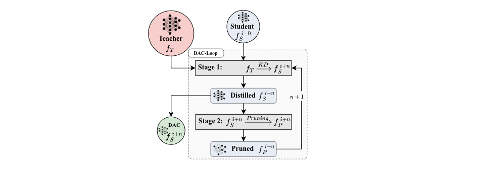

# DAC-LOOP: DISTILLATION-AWARE COMPRESSION FOR REMOTE SENSING CNN

<!-- TODO arXiv: replace both "coming_soon" in the badge URL and "XXXX.XXXXX" in the link with the arXiv ID (e.g. 2607.03551) -->
<p align="center">
  <a href="https://arxiv.org/abs/2610.35175"></a>
  <a href="https://doi.org/10.1109/IGARSS60577.2026.11730294"></a>
  <a href="docs/poster_IGARSS-2026/IGARSS2026%20Poster.pdf"></a>
</p>

## Project Overview

This is the official implementation of the paper: DAC-Lop: Distillation-Aware Compression for Remote Sensing CNN.
The goal of this work is to explore how much a knowledge-distilled student model can be further compressed
while preserving high level of accuracy on RS scene classification. In particular, our main contributions are:

- We introduce a Distillation-Aware Compression Loop tailored to CNN backbones and evaluated on `EuroSAT` and
  `NWPU-RESISC45`.
- Ablation studies demonstrate that iterative DAC-Loop cycles outperform standard one-shot pruning on every level of compression.

Our proposed DAC-Loop approach achieves state-of-the-art results on the `NWPU-RESISC45` dataset with a ResNet18
backbone,
compressing the model by 84.7% (1.7 M Parameters) while still achieving 91.61% accuracy.
We implemented a dynamic framework allowing to create scheduled compression loops. The loop follows these steps:

1. A teacher model is trained on the dataset.
2. A student model (smaller than teacher) is trained using knowledge distillation from the teacher.
3. The KD-trained student model is compressed via structured or unstructured pruning.
4. The compressed model becomes the new student, and steps 2-4 are repeated for N iterations.

The framework allows to flexibly define different compression rates, methods and parameters during each iteration. This
enables a possibility to start in a first iteration e.g. with global unstructured pruning with a low compression rate
and end with structured pruning with a high compression rate in the last iteration.

## Project Structure

The directory structure of **DAC-Loop** is organized as follows:


---

### Module Overview

| Directory                       | Description                                                                                   |
|---------------------------------|-----------------------------------------------------------------------------------------------|
| **[experiments](experiments/)** | Contains the experiment configurations and the results                                        |
| **[framework](framework/)**     | This is the core of the DAC-Loop. It contains the complete logic to handle KD and Compression |
| **[notebooks](notebooks/)**     | Notebooks for data exploration                                                                |
| **[runner.py](runner.py)**      | The primary script to execute experiments                                                     |

## Getting Started

The project uses UV as the main dependency manager. To set up the environment, follow these steps:

1. **Clone the Repository**:

```bash
git clone https://github.com/RicoStaedeli/DAC-Loop.git
cd DAC-Loop
```

2. **Install Dependencies**:

```bash
pip install uv      # Install UV if not already installed
uv install
```

3. **Run Experiments**:
   The experiments are defined in the [configs](experiments/configurations) directory. Each Experiments consist of an
   `Experiment_Orchestrator_Config.toml`
   file and the corresponding `Run-xy.toml` files. The orchestrator config defines which runs to execute. The parameters
   of the specific run are in the run config files.
   An example experiment can be found in [Experiment_XY](experiments/configurations/Experiment_XY). The name
   of the experiment folder is
   passed as an argument to the `runner.py` script.

   To execute an experiment, use the following command:

```bash
uv run runner.py --gpu 0 --experiment Experiment_XY
```

## Evaluation

The following table summarizes the evaluation results of our DAC-Loop approach on the `NWPU-RESISC45` dataset using a
[ResNet18](framework/models/ResNet18.py) backbone.
The table compares the base model, compressed models without knowledge distillation (KD), and models trained with KD.
Also included are the results of our DAC-Loop approach with multiple iterations (N) of compression and KD.

**ResNet18 Ablation Study Results on NWPU-RESISC45**

|                   | KD-1 | KD-2 | Iterations (N) | Compression |  Params |        Val. Acc. |
|-------------------|-----:|:----:|---------------:|------------:|--------:|-----------------:|
| **KD**            |    ✓ |  –   |              1 |          0% |  1.0 M* |     82.63 ± 0.32 |
|                   |    ✓ |  –   |              1 |          0% | 2.0 M** |     86.36 ± 0.37 |
|                   |    ✓ |  –   |              1 |          0% |  11.2 M |     91.95 ± 0.17 |
| **Compression+**  |    – |  –   |              1 |       46.0% |   6.0 M |     90.78 ± 0.11 |
|                   |    ✓ |  –   |              1 |       46.0% |   6.0 M |     82.02 ± 0.15 |
|                   |    – |  ✓   |              1 |       46.0% |   6.0 M |     92.10 ± 0.04 |
|                   |    ✓ |  ✓   |              1 |       46.0% |   6.0 M |     92.22 ± 0.03 |
| **Compression++** |    – |  –   |              1 |       75.0% |   2.8 M |     87.86 ± 0.17 |
|                   |    ✓ |  –   |              1 |       75.0% |   2.8 M |     89.98 ± 0.29 |
|                   |    – |  ✓   |              1 |       75.0% |   2.8 M |     90.13 ± 0.20 |
|                   |    ✓ |  ✓   |              1 |       75.0% |   2.8 M |     91.11 ± 0.08 |
| **Loop**          |    ✓ |  ✓   |              7 |       84.7% |   1.7 M | **91.61 ± 0.24** |
|                   |    ✓ |  ✓   |              9 |       91.7% |   0.9 M |     90.64 ± 0.15 |

\* 1.0M model: [ResNetTiny](framework/models/ResNetTiny.py)<br>
\** 2.0M model: [ResNet10mini](framework/models/ResNet10mini.py)

### Effect of DAC with ResNet18 on NWPU-RESISC45


## Contact

Feel free to get in touch with us with any questions on the project. Reach out
to [rico.staedeli@student.unisg.com](mailto:rico.staedeli@student.unisg.com).
