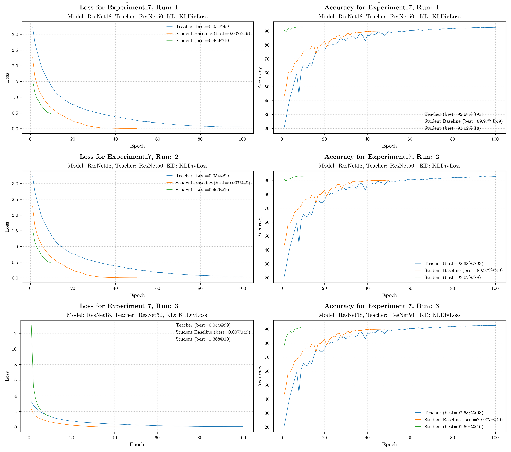

# Experiment Descriptions

This document provides an overview of the experiments conducted, including their goals, configurations, and results. 
Each experiment is organized in a table format for easy reference.

---

## Experiment 1: Baselines Teacher & Students on EuroSAT

**Goal:** Train a large teacher model with ResNet18. The training will be done with different combination of spectral bands.
Also, every smaller model will be trained from scratch as a baseline.

**Description** 
- Models: ResNet50 ResNet18 (teacher), ResNet10, TinyCNN (students)
- Dataset: EuroSAT (`blanchon/EuroSAT_MSI`)
- Baseline were generated for different Band combinations:
  1. All bands: ["B01", "B02", "B03", "B04", "B05", "B06", "B07", "B08", "B8A", "B09", "B11", "B12"]
  2. RGB bands: ["B02", "B03", "B04"]
  3. Vegetation indices + RGB bands: ["NDVI", "NDWI", "NDMI"]["B02", "B03", "B04", "B07", "B08"]

  
<strong>Experiment 1 – overview plot</strong>

  

**Outcomes**
- Baseline results for all models and band combinations
- Even the smallest model (TinyCNN) achieves accuracy ~90.00% when trained with all bands

**Next Steps**
- Try to use this big teacher model (ResNet18) to guide the smaller models with teacher-student learning (Experiment 2)

### Runs
| Run  | Config                                         | Model    | Dataset                | Metrics                                           | Plots                              | Bands                                                                                | Best Accuracy | 
|------|------------------------------------------------|----------|------------------------|---------------------------------------------------|------------------------------------|--------------------------------------------------------------------------------------|---------------|
| [1]  | [Config.toml](Experiment_1/Run_1/config.toml)  | ResNet18 | `blanchon/EuroSAT_MSI` | [metrics.json](Experiment_1/Run_1/metrics.jsonl)  | [plots](Experiment_1/Run_1/plots)  | ['B01', 'B02', 'B03', 'B04', 'B05', 'B06', 'B07', 'B08', 'B8A', 'B09', 'B11', 'B12'] | 98.44% @ 50   |
| [2]  | [Config.toml](Experiment_1/Run_2/config.toml)  | ResNet18 | `blanchon/EuroSAT_MSI` | [metrics.json](Experiment_1/Run_2/metrics.jsonl)  | [plots](Experiment_1/Run_2/plots)  | ['B02', 'B03', 'B04']                                                                | 96.46% @ 42   |
| [3]  | [Config.toml](Experiment_1/Run_3/config.toml)  | ResNet18 | `blanchon/EuroSAT_MSI` | [metrics.json](Experiment_1/Run_3/metrics.jsonl)  | [plots](Experiment_1/Run_3/plots)  | ['NDVI', 'NDWI', 'NDMI', 'B02', 'B03', 'B04', 'B07', 'B08']                          | 97.76% @ 43   |
| [4]  | [Config.toml](Experiment_1/Run_4/config.toml)  | ResNet10 | `blanchon/EuroSAT_MSI` | [metrics.json](Experiment_1/Run_4/metrics.jsonl)  | [plots](Experiment_1/Run_4/plots)  | ['B01', 'B02', 'B03', 'B04', 'B05', 'B06', 'B07', 'B08', 'B8A', 'B09', 'B11', 'B12'] | 98.35% @ 47   |
| [5]  | [Config.toml](Experiment_1/Run_5/config.toml)  | ResNet10 | `blanchon/EuroSAT_MSI` | [metrics.json](Experiment_1/Run_5/metrics.jsonl)  | [plots](Experiment_1/Run_5/plots)  | ['B02', 'B03', 'B04']                                                                | 95.41% @ 40   |
| [6]  | [Config.toml](Experiment_1/Run_6/config.toml)  | ResNet10 | `blanchon/EuroSAT_MSI` | [metrics.json](Experiment_1/Run_6/metrics.jsonl)  | [plots](Experiment_1/Run_6/plots)  | ['NDVI', 'NDWI', 'NDMI', 'B02', 'B03', 'B04', 'B07', 'B08']                          | 97.52% @ 50   |
| [7]  | [Config.toml](Experiment_1/Run_7/config.toml)  | TinyCNN  | `blanchon/EuroSAT_MSI` | [metrics.json](Experiment_1/Run_7/metrics.jsonl)  | [plots](Experiment_1/Run_7/plots)  | ['B01', 'B02', 'B03', 'B04', 'B05', 'B06', 'B07', 'B08', 'B8A', 'B09', 'B11', 'B12'] | 89.22% @ 38   |
| [8]  | [Config.toml](Experiment_1/Run_8/config.toml)  | TinyCNN  | `blanchon/EuroSAT_MSI` | [metrics.json](Experiment_1/Run_8/metrics.jsonl)  | [plots](Experiment_1/Run_8/plots)  | ['B02', 'B03', 'B04']                                                                | 76.80% @ 43   |
| [9]  | [Config.toml](Experiment_1/Run_9/config.toml)  | TinyCNN  | `blanchon/EuroSAT_MSI` | [metrics.json](Experiment_1/Run_9/metrics.jsonl)  | [plots](Experiment_1/Run_9/plots)  | ['NDVI', 'NDWI', 'NDMI', 'B02', 'B03', 'B04', 'B07', 'B08']                          | 87.87% @ 43   |
| [10] | [Config.toml](Experiment_1/Run_10/config.toml) | ResNet50 | `blanchon/EuroSAT_MSI` | [metrics.json](Experiment_1/Run_10/metrics.jsonl) | [plots](Experiment_1/Run_10/plots) | ['B01', 'B02', 'B03', 'B04', 'B05', 'B06', 'B07', 'B08', 'B8A', 'B09', 'B11', 'B12'] | 98.50% @ 43   |
| [11] | [Config.toml](Experiment_1/Run_11/config.toml) | ResNet50 | `blanchon/EuroSAT_MSI` | [metrics.json](Experiment_1/Run_11/metrics.jsonl) | [plots](Experiment_1/Run_11/plots) | ['B02', 'B03', 'B04']                                                                | 97.31% @ 46   |
| [12] | [Config.toml](Experiment_1/Run_12/config.toml) | ResNet50 | `blanchon/EuroSAT_MSI` | [metrics.json](Experiment_1/Run_12/metrics.jsonl) | [plots](Experiment_1/Run_12/plots) | ['NDVI', 'NDWI', 'NDMI', 'B02', 'B03', 'B04', 'B07', 'B08']                          | 98.31% @ 44   |

## Experiment 2: Teacher-Student learning (replaced by Experiment 3 and 4)
**Goal:** Train the smaller models (ResNet10 and TiniCNN) with teacher-student training. Use the best teacher model (best validation loss) ResNet18 as a guiding teacher.
This experiment was later replaced by Experiment 3 and 4 which include hyperparameter tuning.

Experiment 1– extra notes & insights

- space for extra comments here

**Outcomes**
- Teacher-Student learning works in theory but did not improve the baseline results in practice

**Next Steps**
- Hyperparameter tuning for the student model training (Experiment 3 and 4)
- Try bigger models as teachers --> Do Baseline for ResNet50 (done in Experiment 1, Runs 10-12)
- Try ResNet18 as student and ResNet50 as teacher (Experiment 4)

### Runs
| Run | Config                                        | Model    | Model Teacher | Dataset                | KD-Type          | Metrics                                          | Plots                             | Bands                                                                                | Best Accuracy | Baseline Accuracy | Improvement to Baseline |
|-----|-----------------------------------------------|----------|---------------|------------------------|------------------|--------------------------------------------------|-----------------------------------|--------------------------------------------------------------------------------------|---------------|-------------------|-------------------------|
| [1] | [Config.toml](Experiment_2/Run_1/config.toml) | ResNet10 | ResNet18      | `blanchon/EuroSAT_MSI` | CrossEntropyLoss | [metrics.json](Experiment_2/Run_1/metrics.jsonl) | [plots](Experiment_2/Run_1/plots) | ['B01', 'B02', 'B03', 'B04', 'B05', 'B06', 'B07', 'B08', 'B8A', 'B09', 'B11', 'B12'] | 0.00% @ -1    | 0.00%             | 0.00%                   |
| [2] | [Config.toml](Experiment_2/Run_2/config.toml) | ResNet10 | ResNet18      | `blanchon/EuroSAT_MSI` | CrossEntropyLoss | [metrics.json](Experiment_2/Run_2/metrics.jsonl) | [plots](Experiment_2/Run_2/plots) | ['B02', 'B03', 'B04']                                                                | 0.00% @ -1    | 0.00%             | 0.00%                   |
| [3] | [Config.toml](Experiment_2/Run_3/config.toml) | ResNet10 | ResNet18      | `blanchon/EuroSAT_MSI` | CrossEntropyLoss | [metrics.json](Experiment_2/Run_3/metrics.jsonl) | [plots](Experiment_2/Run_3/plots) | ['NDVI', 'NDWI', 'NDMI', 'B02', 'B03', 'B04', 'B07', 'B08']                          | 0.00% @ -1    | 0.00%             | 0.00%                   |
| [4] | [Config.toml](Experiment_2/Run_4/config.toml) | TinyCNN  | ResNet18      | `blanchon/EuroSAT_MSI` | CrossEntropyLoss | [metrics.json](Experiment_2/Run_4/metrics.jsonl) | [plots](Experiment_2/Run_4/plots) | ['B01', 'B02', 'B03', 'B04', 'B05', 'B06', 'B07', 'B08', 'B8A', 'B09', 'B11', 'B12'] | 0.00% @ -1    | 0.00%             | 0.00%                   |
| [5] | [Config.toml](Experiment_2/Run_5/config.toml) | TinyCNN  | ResNet18      | `blanchon/EuroSAT_MSI` | CrossEntropyLoss | [metrics.json](Experiment_2/Run_5/metrics.jsonl) | [plots](Experiment_2/Run_5/plots) | ['B02', 'B03', 'B04']                                                                | 0.00% @ -1    | 0.00%             | 0.00%                   |
| [6] | [Config.toml](Experiment_2/Run_6/config.toml) | TinyCNN  | ResNet18      | `blanchon/EuroSAT_MSI` | CrossEntropyLoss | [metrics.json](Experiment_2/Run_6/metrics.jsonl) | [plots](Experiment_2/Run_6/plots) | ['NDVI', 'NDWI', 'NDMI', 'B02', 'B03', 'B04', 'B07', 'B08']                          | 0.00% @ -1    | 0.00%             | 0.00%                   |

## Experiment 3: Hyperparameter-tuning - EuroSAT, TinyCNN, ResNet18
**Goal:** Train the smaller models (TinyCNN) with teacher-student training. Use the best teacher model (best validation loss) ResNet18 as a guiding teacher.
In this experiment we will do hyperparameter tuning for the student model training. Also we use different knowledge distillation methods such as CosineEmbeddingLoss, CrossEntropyLoss and KLDivergenceLoss.

[Results](Experiment_3/results_summary.md)

  
Experiment 3 – overview plot

  

**Outcomes**
- No Hyperparameter combination was able to outperform the baseline TinyCNN model trained from scratch

**Next Steps**
- Try bigger models as students and Teacher (Experiment 4)

### Runs
| Run  | Config                                         | Model   | Model Teacher | Dataset                | KD-Type          | Metrics                                           | Plots                              | Bands                                                       | Best Accuracy | Baseline Accuracy | Improvement to Baseline |
|------|------------------------------------------------|---------|---------------|------------------------|------------------|---------------------------------------------------|------------------------------------|-------------------------------------------------------------|---------------|-------------------|-------------------------|
| [1]  | [Config.toml](Experiment_3/Run_1/config.toml)  | TinyCNN | ResNet18      | `blanchon/EuroSAT_MSI` | CrossEntropyLoss | [metrics.json](Experiment_3/Run_1/metrics.jsonl)  | [plots](Experiment_3/Run_1/plots)  | ['NDVI', 'NDWI', 'NDMI', 'B02', 'B03', 'B04', 'B07', 'B08'] | 87.28% @ 46   | 87.87%            | -0.59%                  |
| [2]  | [Config.toml](Experiment_3/Run_2/config.toml)  | TinyCNN | ResNet18      | `blanchon/EuroSAT_MSI` | CrossEntropyLoss | [metrics.json](Experiment_3/Run_2/metrics.jsonl)  | [plots](Experiment_3/Run_2/plots)  | ['NDVI', 'NDWI', 'NDMI', 'B02', 'B03', 'B04', 'B07', 'B08'] | 86.89% @ 47   | 87.87%            | -0.98%                  |
| [3]  | [Config.toml](Experiment_3/Run_3/config.toml)  | TinyCNN | ResNet18      | `blanchon/EuroSAT_MSI` | CrossEntropyLoss | [metrics.json](Experiment_3/Run_3/metrics.jsonl)  | [plots](Experiment_3/Run_3/plots)  | ['NDVI', 'NDWI', 'NDMI', 'B02', 'B03', 'B04', 'B07', 'B08'] | 87.33% @ 44   | 87.87%            | -0.54%                  |
| [4]  | [Config.toml](Experiment_3/Run_4/config.toml)  | TinyCNN | ResNet18      | `blanchon/EuroSAT_MSI` | CrossEntropyLoss | [metrics.json](Experiment_3/Run_4/metrics.jsonl)  | [plots](Experiment_3/Run_4/plots)  | ['NDVI', 'NDWI', 'NDMI', 'B02', 'B03', 'B04', 'B07', 'B08'] | 87.37% @ 38   | 87.87%            | -0.50%                  |
| [5]  | [Config.toml](Experiment_3/Run_5/config.toml)  | TinyCNN | ResNet18      | `blanchon/EuroSAT_MSI` | CrossEntropyLoss | [metrics.json](Experiment_3/Run_5/metrics.jsonl)  | [plots](Experiment_3/Run_5/plots)  | ['NDVI', 'NDWI', 'NDMI', 'B02', 'B03', 'B04', 'B07', 'B08'] | 87.59% @ 48   | 87.87%            | -0.28%                  |
| [6]  | [Config.toml](Experiment_3/Run_6/config.toml)  | TinyCNN | ResNet18      | `blanchon/EuroSAT_MSI` | CrossEntropyLoss | [metrics.json](Experiment_3/Run_6/metrics.jsonl)  | [plots](Experiment_3/Run_6/plots)  | ['NDVI', 'NDWI', 'NDMI', 'B02', 'B03', 'B04', 'B07', 'B08'] | 87.56% @ 46   | 87.87%            | -0.31%                  |
| [7]  | [Config.toml](Experiment_3/Run_7/config.toml)  | TinyCNN | ResNet18      | `blanchon/EuroSAT_MSI` | CrossEntropyLoss | [metrics.json](Experiment_3/Run_7/metrics.jsonl)  | [plots](Experiment_3/Run_7/plots)  | ['NDVI', 'NDWI', 'NDMI', 'B02', 'B03', 'B04', 'B07', 'B08'] | 87.31% @ 46   | 87.87%            | -0.56%                  |
| [8]  | [Config.toml](Experiment_3/Run_8/config.toml)  | TinyCNN | ResNet18      | `blanchon/EuroSAT_MSI` | CrossEntropyLoss | [metrics.json](Experiment_3/Run_8/metrics.jsonl)  | [plots](Experiment_3/Run_8/plots)  | ['NDVI', 'NDWI', 'NDMI', 'B02', 'B03', 'B04', 'B07', 'B08'] | 86.96% @ 44   | 87.87%            | -0.91%                  |
| [9]  | [Config.toml](Experiment_3/Run_9/config.toml)  | TinyCNN | ResNet18      | `blanchon/EuroSAT_MSI` | CrossEntropyLoss | [metrics.json](Experiment_3/Run_9/metrics.jsonl)  | [plots](Experiment_3/Run_9/plots)  | ['NDVI', 'NDWI', 'NDMI', 'B02', 'B03', 'B04', 'B07', 'B08'] | 86.83% @ 47   | 87.87%            | -1.04%                  |
| [10] | [Config.toml](Experiment_3/Run_10/config.toml) | TinyCNN | ResNet18      | `blanchon/EuroSAT_MSI` | CrossEntropyLoss | [metrics.json](Experiment_3/Run_10/metrics.jsonl) | [plots](Experiment_3/Run_10/plots) | ['NDVI', 'NDWI', 'NDMI', 'B02', 'B03', 'B04', 'B07', 'B08'] | 87.06% @ 43   | 87.87%            | -0.81%                  |
| [11] | [Config.toml](Experiment_3/Run_11/config.toml) | TinyCNN | ResNet18      | `blanchon/EuroSAT_MSI` | CrossEntropyLoss | [metrics.json](Experiment_3/Run_11/metrics.jsonl) | [plots](Experiment_3/Run_11/plots) | ['NDVI', 'NDWI', 'NDMI', 'B02', 'B03', 'B04', 'B07', 'B08'] | 86.07% @ 43   | 87.87%            | -1.80%                  |
| [12] | [Config.toml](Experiment_3/Run_12/config.toml) | TinyCNN | ResNet18      | `blanchon/EuroSAT_MSI` | CrossEntropyLoss | [metrics.json](Experiment_3/Run_12/metrics.jsonl) | [plots](Experiment_3/Run_12/plots) | ['NDVI', 'NDWI', 'NDMI', 'B02', 'B03', 'B04', 'B07', 'B08'] | 86.37% @ 44   | 87.87%            | -1.50%                  |
| [13] | [Config.toml](Experiment_3/Run_13/config.toml) | TinyCNN | ResNet18      | `blanchon/EuroSAT_MSI` | CrossEntropyLoss | [metrics.json](Experiment_3/Run_13/metrics.jsonl) | [plots](Experiment_3/Run_13/plots) | ['NDVI', 'NDWI', 'NDMI', 'B02', 'B03', 'B04', 'B07', 'B08'] | 86.74% @ 38   | 87.87%            | -1.13%                  |
| [14] | [Config.toml](Experiment_3/Run_14/config.toml) | TinyCNN | ResNet18      | `blanchon/EuroSAT_MSI` | CrossEntropyLoss | [metrics.json](Experiment_3/Run_14/metrics.jsonl) | [plots](Experiment_3/Run_14/plots) | ['NDVI', 'NDWI', 'NDMI', 'B02', 'B03', 'B04', 'B07', 'B08'] | 86.80% @ 39   | 87.87%            | -1.07%                  |
| [15] | [Config.toml](Experiment_3/Run_15/config.toml) | TinyCNN | ResNet18      | `blanchon/EuroSAT_MSI` | CrossEntropyLoss | [metrics.json](Experiment_3/Run_15/metrics.jsonl) | [plots](Experiment_3/Run_15/plots) | ['NDVI', 'NDWI', 'NDMI', 'B02', 'B03', 'B04', 'B07', 'B08'] | 87.00% @ 39   | 87.87%            | -0.87%                  |
| [16] | [Config.toml](Experiment_3/Run_16/config.toml) | TinyCNN | ResNet18      | `blanchon/EuroSAT_MSI` | CrossEntropyLoss | [metrics.json](Experiment_3/Run_16/metrics.jsonl) | [plots](Experiment_3/Run_16/plots) | ['NDVI', 'NDWI', 'NDMI', 'B02', 'B03', 'B04', 'B07', 'B08'] | 87.04% @ 39   | 87.87%            | -0.83%                  |
| [17] | [Config.toml](Experiment_3/Run_17/config.toml) | TinyCNN | ResNet18      | `blanchon/EuroSAT_MSI` | CrossEntropyLoss | [metrics.json](Experiment_3/Run_17/metrics.jsonl) | [plots](Experiment_3/Run_17/plots) | ['NDVI', 'NDWI', 'NDMI', 'B02', 'B03', 'B04', 'B07', 'B08'] | 86.61% @ 43   | 87.87%            | -1.26%                  |
| [18] | [Config.toml](Experiment_3/Run_18/config.toml) | TinyCNN | ResNet18      | `blanchon/EuroSAT_MSI` | CrossEntropyLoss | [metrics.json](Experiment_3/Run_18/metrics.jsonl) | [plots](Experiment_3/Run_18/plots) | ['NDVI', 'NDWI', 'NDMI', 'B02', 'B03', 'B04', 'B07', 'B08'] | 86.65% @ 38   | 87.87%            | -1.22%                  |
| [19] | [Config.toml](Experiment_3/Run_19/config.toml) | TinyCNN | ResNet18      | `blanchon/EuroSAT_MSI` | CrossEntropyLoss | [metrics.json](Experiment_3/Run_19/metrics.jsonl) | [plots](Experiment_3/Run_19/plots) | ['NDVI', 'NDWI', 'NDMI', 'B02', 'B03', 'B04', 'B07', 'B08'] | 86.30% @ 38   | 87.87%            | -1.57%                  |
| [20] | [Config.toml](Experiment_3/Run_20/config.toml) | TinyCNN | ResNet18      | `blanchon/EuroSAT_MSI` | CrossEntropyLoss | [metrics.json](Experiment_3/Run_20/metrics.jsonl) | [plots](Experiment_3/Run_20/plots) | ['NDVI', 'NDWI', 'NDMI', 'B02', 'B03', 'B04', 'B07', 'B08'] | 86.24% @ 38   | 87.87%            | -1.63%                  |
| [21] | [Config.toml](Experiment_3/Run_21/config.toml) | TinyCNN | ResNet18      | `blanchon/EuroSAT_MSI` | CrossEntropyLoss | [metrics.json](Experiment_3/Run_21/metrics.jsonl) | [plots](Experiment_3/Run_21/plots) | ['NDVI', 'NDWI', 'NDMI', 'B02', 'B03', 'B04', 'B07', 'B08'] | 86.30% @ 38   | 87.87%            | -1.57%                  |
| [22] | [Config.toml](Experiment_3/Run_22/config.toml) | TinyCNN | ResNet18      | `blanchon/EuroSAT_MSI` | CrossEntropyLoss | [metrics.json](Experiment_3/Run_22/metrics.jsonl) | [plots](Experiment_3/Run_22/plots) | ['NDVI', 'NDWI', 'NDMI', 'B02', 'B03', 'B04', 'B07', 'B08'] | 85.00% @ 42   | 87.87%            | -2.87%                  |
| [23] | [Config.toml](Experiment_3/Run_23/config.toml) | TinyCNN | ResNet18      | `blanchon/EuroSAT_MSI` | CrossEntropyLoss | [metrics.json](Experiment_3/Run_23/metrics.jsonl) | [plots](Experiment_3/Run_23/plots) | ['NDVI', 'NDWI', 'NDMI', 'B02', 'B03', 'B04', 'B07', 'B08'] | 85.09% @ 36   | 87.87%            | -2.78%                  |
| [24] | [Config.toml](Experiment_3/Run_24/config.toml) | TinyCNN | ResNet18      | `blanchon/EuroSAT_MSI` | CrossEntropyLoss | [metrics.json](Experiment_3/Run_24/metrics.jsonl) | [plots](Experiment_3/Run_24/plots) | ['NDVI', 'NDWI', 'NDMI', 'B02', 'B03', 'B04', 'B07', 'B08'] | 84.76% @ 42   | 87.87%            | -3.11%                  |

## Experiment 4: Hyperparameter-tuning - EuroSAT, ResNet18, ResNet50
**Goal:** Train the smaller model (ResNet18) with teacher-student training. Use the best teacher model (best validation loss) ResNet50 as a guiding teacher.
In this experiment we will do hyperparameter tuning for the student model training. Also, we use different knowledge distillation methods such as CosineEmbeddingLoss, CrossEntropyLoss and KLDivergenceLoss.

[Results](Experiment_4/results_summary.md)

  
Experiment 4 – overview plot

  

**Outcomes**
- The baseline of the Student model (ResNet18) could be beaten with Teacher-Student learning using ResNet50 as teacher.
- The student model achieved better performance than the teacher model. --> Dataset could be to simple and therefore we change it to a more complex one in future experiments.
- Build Baseline for models on `RESISC45` Dataset (Experiment 5)

### Runs
| Run  | Config                                         | Model    | Model Teacher | Dataset                | KD-Type          | Metrics                                           | Plots                              | Bands                                                       | Best Accuracy | Baseline Accuracy | Improvement to Baseline |
|------|------------------------------------------------|----------|---------------|------------------------|------------------|---------------------------------------------------|------------------------------------|-------------------------------------------------------------|---------------|-------------------|-------------------------|
| [1]  | [Config.toml](Experiment_4/Run_1/config.toml)  | ResNet18 | ResNet50      | `blanchon/EuroSAT_MSI` | CrossEntropyLoss | [metrics.json](Experiment_4/Run_1/metrics.jsonl)  | [plots](Experiment_4/Run_1/plots)  | ['NDVI', 'NDWI', 'NDMI', 'B02', 'B03', 'B04', 'B07', 'B08'] | 98.19% @ 42   | 97.52%            | 0.67%                   |
| [2]  | [Config.toml](Experiment_4/Run_2/config.toml)  | ResNet18 | ResNet50      | `blanchon/EuroSAT_MSI` | CrossEntropyLoss | [metrics.json](Experiment_4/Run_2/metrics.jsonl)  | [plots](Experiment_4/Run_2/plots)  | ['NDVI', 'NDWI', 'NDMI', 'B02', 'B03', 'B04', 'B07', 'B08'] | 98.31% @ 37   | 97.52%            | 0.80%                   |
| [3]  | [Config.toml](Experiment_4/Run_3/config.toml)  | ResNet18 | ResNet50      | `blanchon/EuroSAT_MSI` | CrossEntropyLoss | [metrics.json](Experiment_4/Run_3/metrics.jsonl)  | [plots](Experiment_4/Run_3/plots)  | ['NDVI', 'NDWI', 'NDMI', 'B02', 'B03', 'B04', 'B07', 'B08'] | 98.41% @ 42   | 97.52%            | 0.89%                   |
| [4]  | [Config.toml](Experiment_4/Run_4/config.toml)  | ResNet18 | ResNet50      | `blanchon/EuroSAT_MSI` | CrossEntropyLoss | [metrics.json](Experiment_4/Run_4/metrics.jsonl)  | [plots](Experiment_4/Run_4/plots)  | ['NDVI', 'NDWI', 'NDMI', 'B02', 'B03', 'B04', 'B07', 'B08'] | 98.37% @ 37   | 97.52%            | 0.85%                   |
| [5]  | [Config.toml](Experiment_4/Run_5/config.toml)  | ResNet18 | ResNet50      | `blanchon/EuroSAT_MSI` | CrossEntropyLoss | [metrics.json](Experiment_4/Run_5/metrics.jsonl)  | [plots](Experiment_4/Run_5/plots)  | ['NDVI', 'NDWI', 'NDMI', 'B02', 'B03', 'B04', 'B07', 'B08'] | 98.43% @ 38   | 97.52%            | 0.91%                   |
| [6]  | [Config.toml](Experiment_4/Run_6/config.toml)  | ResNet18 | ResNet50      | `blanchon/EuroSAT_MSI` | CrossEntropyLoss | [metrics.json](Experiment_4/Run_6/metrics.jsonl)  | [plots](Experiment_4/Run_6/plots)  | ['NDVI', 'NDWI', 'NDMI', 'B02', 'B03', 'B04', 'B07', 'B08'] | 98.44% @ 32   | 97.52%            | 0.93%                   |
| [7]  | [Config.toml](Experiment_4/Run_7/config.toml)  | ResNet18 | ResNet50      | `blanchon/EuroSAT_MSI` | CrossEntropyLoss | [metrics.json](Experiment_4/Run_7/metrics.jsonl)  | [plots](Experiment_4/Run_7/plots)  | ['NDVI', 'NDWI', 'NDMI', 'B02', 'B03', 'B04', 'B07', 'B08'] | 98.39% @ 48   | 97.52%            | 0.87%                   |
| [8]  | [Config.toml](Experiment_4/Run_8/config.toml)  | ResNet18 | ResNet50      | `blanchon/EuroSAT_MSI` | CrossEntropyLoss | [metrics.json](Experiment_4/Run_8/metrics.jsonl)  | [plots](Experiment_4/Run_8/plots)  | ['NDVI', 'NDWI', 'NDMI', 'B02', 'B03', 'B04', 'B07', 'B08'] | 98.19% @ 47   | 97.52%            | 0.67%                   |
| [9]  | [Config.toml](Experiment_4/Run_9/config.toml)  | ResNet18 | ResNet50      | `blanchon/EuroSAT_MSI` | CrossEntropyLoss | [metrics.json](Experiment_4/Run_9/metrics.jsonl)  | [plots](Experiment_4/Run_9/plots)  | ['NDVI', 'NDWI', 'NDMI', 'B02', 'B03', 'B04', 'B07', 'B08'] | 98.31% @ 46   | 97.52%            | 0.80%                   |
| [10] | [Config.toml](Experiment_4/Run_10/config.toml) | ResNet18 | ResNet50      | `blanchon/EuroSAT_MSI` | CrossEntropyLoss | [metrics.json](Experiment_4/Run_10/metrics.jsonl) | [plots](Experiment_4/Run_10/plots) | ['NDVI', 'NDWI', 'NDMI', 'B02', 'B03', 'B04', 'B07', 'B08'] | 98.28% @ 32   | 97.52%            | 0.76%                   |
| [11] | [Config.toml](Experiment_4/Run_11/config.toml) | ResNet18 | ResNet50      | `blanchon/EuroSAT_MSI` | CrossEntropyLoss | [metrics.json](Experiment_4/Run_11/metrics.jsonl) | [plots](Experiment_4/Run_11/plots) | ['NDVI', 'NDWI', 'NDMI', 'B02', 'B03', 'B04', 'B07', 'B08'] | 98.31% @ 27   | 97.52%            | 0.80%                   |
| [12] | [Config.toml](Experiment_4/Run_12/config.toml) | ResNet18 | ResNet50      | `blanchon/EuroSAT_MSI` | CrossEntropyLoss | [metrics.json](Experiment_4/Run_12/metrics.jsonl) | [plots](Experiment_4/Run_12/plots) | ['NDVI', 'NDWI', 'NDMI', 'B02', 'B03', 'B04', 'B07', 'B08'] | 98.22% @ 37   | 97.52%            | 0.70%                   |
| [13] | [Config.toml](Experiment_4/Run_13/config.toml) | ResNet18 | ResNet50      | `blanchon/EuroSAT_MSI` | CrossEntropyLoss | [metrics.json](Experiment_4/Run_13/metrics.jsonl) | [plots](Experiment_4/Run_13/plots) | ['NDVI', 'NDWI', 'NDMI', 'B02', 'B03', 'B04', 'B07', 'B08'] | 98.24% @ 35   | 97.52%            | 0.72%                   |
| [14] | [Config.toml](Experiment_4/Run_14/config.toml) | ResNet18 | ResNet50      | `blanchon/EuroSAT_MSI` | CrossEntropyLoss | [metrics.json](Experiment_4/Run_14/metrics.jsonl) | [plots](Experiment_4/Run_14/plots) | ['NDVI', 'NDWI', 'NDMI', 'B02', 'B03', 'B04', 'B07', 'B08'] | 98.37% @ 41   | 97.52%            | 0.85%                   |
| [15] | [Config.toml](Experiment_4/Run_15/config.toml) | ResNet18 | ResNet50      | `blanchon/EuroSAT_MSI` | CrossEntropyLoss | [metrics.json](Experiment_4/Run_15/metrics.jsonl) | [plots](Experiment_4/Run_15/plots) | ['NDVI', 'NDWI', 'NDMI', 'B02', 'B03', 'B04', 'B07', 'B08'] | 98.39% @ 41   | 97.52%            | 0.87%                   |
| [16] | [Config.toml](Experiment_4/Run_16/config.toml) | ResNet18 | ResNet50      | `blanchon/EuroSAT_MSI` | CrossEntropyLoss | [metrics.json](Experiment_4/Run_16/metrics.jsonl) | [plots](Experiment_4/Run_16/plots) | ['NDVI', 'NDWI', 'NDMI', 'B02', 'B03', 'B04', 'B07', 'B08'] | 98.30% @ 34   | 97.52%            | 0.78%                   |
| [17] | [Config.toml](Experiment_4/Run_17/config.toml) | ResNet18 | ResNet50      | `blanchon/EuroSAT_MSI` | CrossEntropyLoss | [metrics.json](Experiment_4/Run_17/metrics.jsonl) | [plots](Experiment_4/Run_17/plots) | ['NDVI', 'NDWI', 'NDMI', 'B02', 'B03', 'B04', 'B07', 'B08'] | 98.37% @ 44   | 97.52%            | 0.85%                   |
| [18] | [Config.toml](Experiment_4/Run_18/config.toml) | ResNet18 | ResNet50      | `blanchon/EuroSAT_MSI` | CrossEntropyLoss | [metrics.json](Experiment_4/Run_18/metrics.jsonl) | [plots](Experiment_4/Run_18/plots) | ['NDVI', 'NDWI', 'NDMI', 'B02', 'B03', 'B04', 'B07', 'B08'] | 98.30% @ 35   | 97.52%            | 0.78%                   |
| [19] | [Config.toml](Experiment_4/Run_19/config.toml) | ResNet18 | ResNet50      | `blanchon/EuroSAT_MSI` | CrossEntropyLoss | [metrics.json](Experiment_4/Run_19/metrics.jsonl) | [plots](Experiment_4/Run_19/plots) | ['NDVI', 'NDWI', 'NDMI', 'B02', 'B03', 'B04', 'B07', 'B08'] | 98.33% @ 41   | 97.52%            | 0.81%                   |
| [20] | [Config.toml](Experiment_4/Run_20/config.toml) | ResNet18 | ResNet50      | `blanchon/EuroSAT_MSI` | CrossEntropyLoss | [metrics.json](Experiment_4/Run_20/metrics.jsonl) | [plots](Experiment_4/Run_20/plots) | ['NDVI', 'NDWI', 'NDMI', 'B02', 'B03', 'B04', 'B07', 'B08'] | 98.28% @ 41   | 97.52%            | 0.76%                   |
| [21] | [Config.toml](Experiment_4/Run_21/config.toml) | ResNet18 | ResNet50      | `blanchon/EuroSAT_MSI` | CrossEntropyLoss | [metrics.json](Experiment_4/Run_21/metrics.jsonl) | [plots](Experiment_4/Run_21/plots) | ['NDVI', 'NDWI', 'NDMI', 'B02', 'B03', 'B04', 'B07', 'B08'] | 98.33% @ 37   | 97.52%            | 0.81%                   |
| [22] | [Config.toml](Experiment_4/Run_22/config.toml) | ResNet18 | ResNet50      | `blanchon/EuroSAT_MSI` | CrossEntropyLoss | [metrics.json](Experiment_4/Run_22/metrics.jsonl) | [plots](Experiment_4/Run_22/plots) | ['NDVI', 'NDWI', 'NDMI', 'B02', 'B03', 'B04', 'B07', 'B08'] | 98.35% @ 34   | 97.52%            | 0.83%                   |
| [23] | [Config.toml](Experiment_4/Run_23/config.toml) | ResNet18 | ResNet50      | `blanchon/EuroSAT_MSI` | CrossEntropyLoss | [metrics.json](Experiment_4/Run_23/metrics.jsonl) | [plots](Experiment_4/Run_23/plots) | ['NDVI', 'NDWI', 'NDMI', 'B02', 'B03', 'B04', 'B07', 'B08'] | 98.22% @ 34   | 97.52%            | 0.70%                   |
| [24] | [Config.toml](Experiment_4/Run_24/config.toml) | ResNet18 | ResNet50      | `blanchon/EuroSAT_MSI` | CrossEntropyLoss | [metrics.json](Experiment_4/Run_24/metrics.jsonl) | [plots](Experiment_4/Run_24/plots) | ['NDVI', 'NDWI', 'NDMI', 'B02', 'B03', 'B04', 'B07', 'B08'] | 98.52% @ 41   | 97.52%            | 1.00%                   |

## Experiment 5: Baseline Teacher & Student on RESISC45
**Goal:** In this experiment we will establish a baseline using the `RESISC45` dataset. We will train different models (ResNet18, ResNet18, ResNet50, TinyCNN) on the RESISC45 dataset and evaluate their performance.

  
Experiment 5 – overview plot

  

### Runs
| Run | Config                                        | Model    | Dataset         | Metrics                                          | Plots                             | Bands                 | Best Accuracy | 
|-----|-----------------------------------------------|----------|-----------------|--------------------------------------------------|-----------------------------------|-----------------------|---------------|
| [1] | [Config.toml](Experiment_5/Run_1/config.toml) | ResNet18 | `timm/resisc45` | [metrics.json](Experiment_5/Run_1/metrics.jsonl) | [plots](Experiment_5/Run_1/plots) | ['B01', 'B02', 'B03'] | 91.33% @ 47   |
| [2] | [Config.toml](Experiment_5/Run_2/config.toml) | ResNet10 | `timm/resisc45` | [metrics.json](Experiment_5/Run_2/metrics.jsonl) | [plots](Experiment_5/Run_2/plots) | ['B01', 'B02', 'B03'] | 88.32% @ 49   |
| [3] | [Config.toml](Experiment_5/Run_3/config.toml) | TinyCNN  | `timm/resisc45` | [metrics.json](Experiment_5/Run_3/metrics.jsonl) | [plots](Experiment_5/Run_3/plots) | ['B01', 'B02', 'B03'] | 29.92% @ 48   |
| [4] | [Config.toml](Experiment_5/Run_4/config.toml) | ResNet50 | `timm/resisc45` | [metrics.json](Experiment_5/Run_4/metrics.jsonl) | [plots](Experiment_5/Run_4/plots) | ['B01', 'B02', 'B03'] | 90.89% @ 50   |
| [5] | [Config.toml](Experiment_5/Run_5/config.toml) | ResNet50 | `timm/resisc45` | [metrics.json](Experiment_5/Run_5/metrics.jsonl) | [plots](Experiment_5/Run_5/plots) | ['B01', 'B02', 'B03'] | 89.30% @ 83   |
| [6] | [Config.toml](Experiment_5/Run_6/config.toml) | ResNet50 | `timm/resisc45` | [metrics.json](Experiment_5/Run_6/metrics.jsonl) | [plots](Experiment_5/Run_6/plots) | ['B01', 'B02', 'B03'] | 81.62% @ 49   |
| [7] | [Config.toml](Experiment_5/Run_7/config.toml) | ResNet50 | `timm/resisc45` | [metrics.json](Experiment_5/Run_7/metrics.jsonl) | [plots](Experiment_5/Run_7/plots) | ['B01', 'B02', 'B03'] | 92.68% @ 93   |
| [8] | [Config.toml](Experiment_5/Run_8/config.toml) | ResNet18 | `timm/resisc45` | [metrics.json](Experiment_5/Run_8/metrics.jsonl) | [plots](Experiment_5/Run_8/plots) | ['B01', 'B02', 'B03'] | 89.97% @ 49   |

## Experiment 6: Hyperparameter-tuning - RESISC45, ResNet18, ResNet50
**Goal:** Train the smaller model (ResNet18) with teacher-student training. Use the best teacher model (best validation loss) ResNet50 as a guiding teacher.
In this experiment we will do hyperparameter tuning for the student model training. Also we use different knowledge distillation methods such as CosineEmbeddingLoss, CrossEntropyLoss and KLDivergenceLoss.
Dataset is the `RESISC45` dataset.

[Results](Experiment_6/results_summary.md)

    
Experiment 6 – overview plot

    

### Runs
| Run  | Config                                         | Model    | Model Teacher | Dataset         | KD-Type             | Metrics                                           | Plots                              | Bands                 | Best Accuracy | Baseline Accuracy | Improvement to Baseline |
|------|------------------------------------------------|----------|---------------|-----------------|---------------------|---------------------------------------------------|------------------------------------|-----------------------|---------------|-------------------|-------------------------|
| [1]  | [Config.toml](Experiment_6/Run_1/config.toml)  | ResNet18 | ResNet50      | `timm/resisc45` | CosineEmbeddingLoss | [metrics.json](Experiment_6/Run_1/metrics.jsonl)  | [plots](Experiment_6/Run_1/plots)  | ['B01', 'B02', 'B03'] | 90.54% @ 42   | 89.97%            | 0.57%                   |
| [2]  | [Config.toml](Experiment_6/Run_2/config.toml)  | ResNet18 | ResNet50      | `timm/resisc45` | CosineEmbeddingLoss | [metrics.json](Experiment_6/Run_2/metrics.jsonl)  | [plots](Experiment_6/Run_2/plots)  | ['B01', 'B02', 'B03'] | 91.03% @ 42   | 89.97%            | 1.06%                   |
| [3]  | [Config.toml](Experiment_6/Run_3/config.toml)  | ResNet18 | ResNet50      | `timm/resisc45` | CosineEmbeddingLoss | [metrics.json](Experiment_6/Run_3/metrics.jsonl)  | [plots](Experiment_6/Run_3/plots)  | ['B01', 'B02', 'B03'] | 91.03% @ 39   | 89.97%            | 1.06%                   |
| [4]  | [Config.toml](Experiment_6/Run_4/config.toml)  | ResNet18 | ResNet50      | `timm/resisc45` | CosineEmbeddingLoss | [metrics.json](Experiment_6/Run_4/metrics.jsonl)  | [plots](Experiment_6/Run_4/plots)  | ['B01', 'B02', 'B03'] | 91.10% @ 43   | 89.97%            | 1.13%                   |
| [5]  | [Config.toml](Experiment_6/Run_5/config.toml)  | ResNet18 | ResNet50      | `timm/resisc45` | CosineEmbeddingLoss | [metrics.json](Experiment_6/Run_5/metrics.jsonl)  | [plots](Experiment_6/Run_5/plots)  | ['B01', 'B02', 'B03'] | 90.95% @ 50   | 89.97%            | 0.98%                   |
| [6]  | [Config.toml](Experiment_6/Run_6/config.toml)  | ResNet18 | ResNet50      | `timm/resisc45` | CosineEmbeddingLoss | [metrics.json](Experiment_6/Run_6/metrics.jsonl)  | [plots](Experiment_6/Run_6/plots)  | ['B01', 'B02', 'B03'] | 91.79% @ 42   | 89.97%            | 1.83%                   |
| [7]  | [Config.toml](Experiment_6/Run_7/config.toml)  | ResNet18 | ResNet50      | `timm/resisc45` | CosineEmbeddingLoss | [metrics.json](Experiment_6/Run_7/metrics.jsonl)  | [plots](Experiment_6/Run_7/plots)  | ['B01', 'B02', 'B03'] | 91.03% @ 42   | 89.97%            | 1.06%                   |
| [8]  | [Config.toml](Experiment_6/Run_8/config.toml)  | ResNet18 | ResNet50      | `timm/resisc45` | CosineEmbeddingLoss | [metrics.json](Experiment_6/Run_8/metrics.jsonl)  | [plots](Experiment_6/Run_8/plots)  | ['B01', 'B02', 'B03'] | 91.30% @ 50   | 89.97%            | 1.33%                   |
| [9]  | [Config.toml](Experiment_6/Run_9/config.toml)  | ResNet18 | ResNet50      | `timm/resisc45` | CosineEmbeddingLoss | [metrics.json](Experiment_6/Run_9/metrics.jsonl)  | [plots](Experiment_6/Run_9/plots)  | ['B01', 'B02', 'B03'] | 90.89% @ 46   | 89.97%            | 0.92%                   |
| [10] | [Config.toml](Experiment_6/Run_10/config.toml) | ResNet18 | ResNet50      | `timm/resisc45` | CosineEmbeddingLoss | [metrics.json](Experiment_6/Run_10/metrics.jsonl) | [plots](Experiment_6/Run_10/plots) | ['B01', 'B02', 'B03'] | 90.65% @ 42   | 89.97%            | 0.68%                   |
| [11] | [Config.toml](Experiment_6/Run_11/config.toml) | ResNet18 | ResNet50      | `timm/resisc45` | CrossEntropyLoss    | [metrics.json](Experiment_6/Run_11/metrics.jsonl) | [plots](Experiment_6/Run_11/plots) | ['B01', 'B02', 'B03'] | 91.17% @ 47   | 89.97%            | 1.21%                   |
| [12] | [Config.toml](Experiment_6/Run_12/config.toml) | ResNet18 | ResNet50      | `timm/resisc45` | CrossEntropyLoss    | [metrics.json](Experiment_6/Run_12/metrics.jsonl) | [plots](Experiment_6/Run_12/plots) | ['B01', 'B02', 'B03'] | 91.06% @ 50   | 89.97%            | 1.10%                   |
| [13] | [Config.toml](Experiment_6/Run_13/config.toml) | ResNet18 | ResNet50      | `timm/resisc45` | CrossEntropyLoss    | [metrics.json](Experiment_6/Run_13/metrics.jsonl) | [plots](Experiment_6/Run_13/plots) | ['B01', 'B02', 'B03'] | 91.05% @ 44   | 89.97%            | 1.08%                   |
| [14] | [Config.toml](Experiment_6/Run_14/config.toml) | ResNet18 | ResNet50      | `timm/resisc45` | CrossEntropyLoss    | [metrics.json](Experiment_6/Run_14/metrics.jsonl) | [plots](Experiment_6/Run_14/plots) | ['B01', 'B02', 'B03'] | 90.92% @ 48   | 89.97%            | 0.95%                   |
| [15] | [Config.toml](Experiment_6/Run_15/config.toml) | ResNet18 | ResNet50      | `timm/resisc45` | CrossEntropyLoss    | [metrics.json](Experiment_6/Run_15/metrics.jsonl) | [plots](Experiment_6/Run_15/plots) | ['B01', 'B02', 'B03'] | 91.03% @ 46   | 89.97%            | 1.06%                   |
| [16] | [Config.toml](Experiment_6/Run_16/config.toml) | ResNet18 | ResNet50      | `timm/resisc45` | CrossEntropyLoss    | [metrics.json](Experiment_6/Run_16/metrics.jsonl) | [plots](Experiment_6/Run_16/plots) | ['B01', 'B02', 'B03'] | 72.24% @ 10   | 89.97%            | -17.73%                 |
| [17] | [Config.toml](Experiment_6/Run_17/config.toml) | ResNet18 | ResNet50      | `timm/resisc45` | CrossEntropyLoss    | [metrics.json](Experiment_6/Run_17/metrics.jsonl) | [plots](Experiment_6/Run_17/plots) | ['B01', 'B02', 'B03'] | 91.08% @ 46   | 89.97%            | 1.11%                   |
| [18] | [Config.toml](Experiment_6/Run_18/config.toml) | ResNet18 | ResNet50      | `timm/resisc45` | CrossEntropyLoss    | [metrics.json](Experiment_6/Run_18/metrics.jsonl) | [plots](Experiment_6/Run_18/plots) | ['B01', 'B02', 'B03'] | 91.19% @ 46   | 89.97%            | 1.22%                   |
| [19] | [Config.toml](Experiment_6/Run_19/config.toml) | ResNet18 | ResNet50      | `timm/resisc45` | CrossEntropyLoss    | [metrics.json](Experiment_6/Run_19/metrics.jsonl) | [plots](Experiment_6/Run_19/plots) | ['B01', 'B02', 'B03'] | 91.14% @ 47   | 89.97%            | 1.17%                   |
| [20] | [Config.toml](Experiment_6/Run_20/config.toml) | ResNet18 | ResNet50      | `timm/resisc45` | CrossEntropyLoss    | [metrics.json](Experiment_6/Run_20/metrics.jsonl) | [plots](Experiment_6/Run_20/plots) | ['B01', 'B02', 'B03'] | 90.97% @ 50   | 89.97%            | 1.00%                   |
| [21] | [Config.toml](Experiment_6/Run_21/config.toml) | ResNet18 | ResNet50      | `timm/resisc45` | CrossEntropyLoss    | [metrics.json](Experiment_6/Run_21/metrics.jsonl) | [plots](Experiment_6/Run_21/plots) | ['B01', 'B02', 'B03'] | 91.56% @ 46   | 89.97%            | 1.59%                   |
| [22] | [Config.toml](Experiment_6/Run_22/config.toml) | ResNet18 | ResNet50      | `timm/resisc45` | CrossEntropyLoss    | [metrics.json](Experiment_6/Run_22/metrics.jsonl) | [plots](Experiment_6/Run_22/plots) | ['B01', 'B02', 'B03'] | 92.22% @ 40   | 89.97%            | 2.25%                   |
| [23] | [Config.toml](Experiment_6/Run_23/config.toml) | ResNet18 | ResNet50      | `timm/resisc45` | CrossEntropyLoss    | [metrics.json](Experiment_6/Run_23/metrics.jsonl) | [plots](Experiment_6/Run_23/plots) | ['B01', 'B02', 'B03'] | 92.98% @ 47   | 89.97%            | 3.02%                   |
| [24] | [Config.toml](Experiment_6/Run_24/config.toml) | ResNet18 | ResNet50      | `timm/resisc45` | RegressorMSE        | [metrics.json](Experiment_6/Run_24/metrics.jsonl) | [plots](Experiment_6/Run_24/plots) | ['B01', 'B02', 'B03'] | 91.63% @ 50   | 89.97%            | 1.67%                   |
| [25] | [Config.toml](Experiment_6/Run_25/config.toml) | ResNet18 | ResNet50      | `timm/resisc45` | RegressorMSE        | [metrics.json](Experiment_6/Run_25/metrics.jsonl) | [plots](Experiment_6/Run_25/plots) | ['B01', 'B02', 'B03'] | 92.03% @ 47   | 89.97%            | 2.06%                   |
| [26] | [Config.toml](Experiment_6/Run_26/config.toml) | ResNet18 | ResNet50      | `timm/resisc45` | RegressorMSE        | [metrics.json](Experiment_6/Run_26/metrics.jsonl) | [plots](Experiment_6/Run_26/plots) | ['B01', 'B02', 'B03'] | 91.94% @ 46   | 89.97%            | 1.97%                   |
| [27] | [Config.toml](Experiment_6/Run_27/config.toml) | ResNet18 | ResNet50      | `timm/resisc45` | RegressorMSE        | [metrics.json](Experiment_6/Run_27/metrics.jsonl) | [plots](Experiment_6/Run_27/plots) | ['B01', 'B02', 'B03'] | 91.21% @ 47   | 89.97%            | 1.24%                   |
| [28] | [Config.toml](Experiment_6/Run_28/config.toml) | ResNet18 | ResNet50      | `timm/resisc45` | RegressorMSE        | [metrics.json](Experiment_6/Run_28/metrics.jsonl) | [plots](Experiment_6/Run_28/plots) | ['B01', 'B02', 'B03'] | 91.37% @ 44   | 89.97%            | 1.40%                   |
| [29] | [Config.toml](Experiment_6/Run_29/config.toml) | ResNet18 | ResNet50      | `timm/resisc45` | KLDivLoss           | [metrics.json](Experiment_6/Run_29/metrics.jsonl) | [plots](Experiment_6/Run_29/plots) | ['B01', 'B02', 'B03'] | 92.02% @ 49   | 89.97%            | 2.05%                   |
| [30] | [Config.toml](Experiment_6/Run_30/config.toml) | ResNet18 | ResNet50      | `timm/resisc45` | KLDivLoss           | [metrics.json](Experiment_6/Run_30/metrics.jsonl) | [plots](Experiment_6/Run_30/plots) | ['B01', 'B02', 'B03'] | 92.11% @ 50   | 89.97%            | 2.14%                   |
| [31] | [Config.toml](Experiment_6/Run_31/config.toml) | ResNet18 | ResNet50      | `timm/resisc45` | KLDivLoss           | [metrics.json](Experiment_6/Run_31/metrics.jsonl) | [plots](Experiment_6/Run_31/plots) | ['B01', 'B02', 'B03'] | 91.38% @ 46   | 89.97%            | 1.41%                   |
| [32] | [Config.toml](Experiment_6/Run_32/config.toml) | ResNet18 | ResNet50      | `timm/resisc45` | KLDivLoss           | [metrics.json](Experiment_6/Run_32/metrics.jsonl) | [plots](Experiment_6/Run_32/plots) | ['B01', 'B02', 'B03'] | 92.21% @ 47   | 91.33%            | 0.87%                   |
| [33] | [Config.toml](Experiment_6/Run_33/config.toml) | ResNet18 | ResNet50      | `timm/resisc45` | KLDivLoss           | [metrics.json](Experiment_6/Run_33/metrics.jsonl) | [plots](Experiment_6/Run_33/plots) | ['B01', 'B02', 'B03'] | 92.13% @ 50   | 89.97%            | 2.16%                   |
| [34] | [Config.toml](Experiment_6/Run_34/config.toml) | ResNet18 | ResNet50      | `timm/resisc45` | KLDivLoss           | [metrics.json](Experiment_6/Run_34/metrics.jsonl) | [plots](Experiment_6/Run_34/plots) | ['B01', 'B02', 'B03'] | 91.94% @ 43   | 89.97%            | 1.97%                   |
| [35] | [Config.toml](Experiment_6/Run_35/config.toml) | ResNet18 | ResNet50      | `timm/resisc45` | KLDivLoss           | [metrics.json](Experiment_6/Run_35/metrics.jsonl) | [plots](Experiment_6/Run_35/plots) | ['B01', 'B02', 'B03'] | 92.16% @ 45   | 89.97%            | 2.19%                   |
| [36] | [Config.toml](Experiment_6/Run_36/config.toml) | ResNet18 | ResNet50      | `timm/resisc45` | KLDivLoss           | [metrics.json](Experiment_6/Run_36/metrics.jsonl) | [plots](Experiment_6/Run_36/plots) | ['B01', 'B02', 'B03'] | 92.40% @ 46   | 89.97%            | 2.43%                   |
| [37] | [Config.toml](Experiment_6/Run_37/config.toml) | ResNet18 | ResNet50      | `timm/resisc45` | KLDivLoss           | [metrics.json](Experiment_6/Run_37/metrics.jsonl) | [plots](Experiment_6/Run_37/plots) | ['B01', 'B02', 'B03'] | 92.13% @ 49   | 89.97%            | 2.16%                   |
| [38] | [Config.toml](Experiment_6/Run_38/config.toml) | ResNet18 | ResNet50      | `timm/resisc45` | KLDivLoss           | [metrics.json](Experiment_6/Run_38/metrics.jsonl) | [plots](Experiment_6/Run_38/plots) | ['B01', 'B02', 'B03'] | 92.21% @ 48   | 89.97%            | 2.24%                   |
| [39] | [Config.toml](Experiment_6/Run_39/config.toml) | ResNet10 | ResNet50      | `timm/resisc45` | KLDivLoss           | [metrics.json](Experiment_6/Run_39/metrics.jsonl) | [plots](Experiment_6/Run_39/plots) | ['B01', 'B02', 'B03'] | 89.10% @ 49   | 88.32%            | 0.78%                   |
| [40] | [Config.toml](Experiment_6/Run_40/config.toml) | ResNet18 | ResNet50      | `timm/resisc45` | KLDivLoss           | [metrics.json](Experiment_6/Run_40/metrics.jsonl) | [plots](Experiment_6/Run_40/plots) | ['B01', 'B02', 'B03'] | 92.75% @ 50   | 89.97%            | 2.78%                   |

## Experiment 7: Compression - RESISC45, ResNet18, ResNet50

**Goal:** In this Experiment we will compress the ResNet18 model using pruning techniques. The compressed models will be fine-tuned with knowledge distillation using the ResNet50 as teacher model. This experiment was done using the best hyperparameters found in Experiment 5 and 6. Only Resic45 dataset is used.

    
Experiment 7 – overview plot

    

