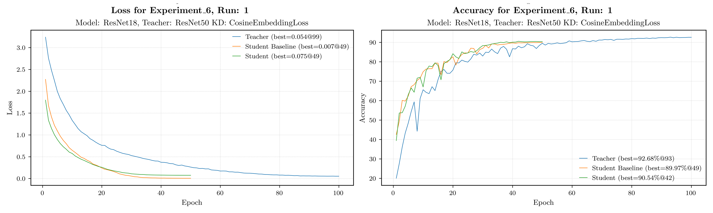

# Experiment Descriptions

In this document we track the different experiments.  
All configurations, results, and decisions are documented for reproducibility.

---

## General Guidelines

For each experiment and run, the following information should be recorded:

- **Date**
- **Author/Responsible**
- **Config file**
- **Model architecture**
- **Dataset (train/val/test)**
- **Preprocessing steps**
- **Hyperparameters**
- **Training duration**
- **Metrics (training/validation/test)**
- **Plots (learning curves, losses, accuracy, etc.)**
- **Observations & Issues**
- **Decisions & Next Steps**

---

## Experiment 1 - baselines

**Goal:** Train a large teacher model with ResNet18. The training will be done with different combination of spectral bands.
Also, every smaller model will be trained from scratch as a baseline.

  
Experiment 1 – overview plot

  

### Runs

| Run | Date       | Author | Config                                                       | Model    | Dataset                  | Hardware   | Train Time         | Metrics                                                        | Plots                                            | Bands                                      | Notes/Issues                                      | Next Steps         |
|-----|------------|--------|--------------------------------------------------------------|----------|--------------------------|------------|--------------------|----------------------------------------------------------------|--------------------------------------------------|---------------------------------------------------|---------------------------------------------------|--------------------|
| [1] | 2025-10-15 | Rico   | [Config.toml](Experiment_1/Run_1/config.toml) | ResNet18 | Train/Val/Test split of blanchon/EuroSAT_MSI | DGX-7 Rico |  | [metrics.json](../experiments/Experiment_1/Run_1/metrics.json) | [plots](Experiment_1/Run_1/plots) | ["B01", "B02", "B03", "B04", "B05", "B06", "B07", "B08", "B8A", "B09", "B11", "B12"] |  | |
| [2] | 2025-10-15 | Rico   | [Config.toml](Experiment_1/Run_2/config.toml) | ResNet18 | Train/Val/Test split of blanchon/EuroSAT_MSI | DGX-7 Rico |  | [metrics.json](../experiments/Experiment_1/Run_2/metrics.json) | [plots](Experiment_1/Run_1/plots) |["B02", "B03", "B04"]|  | |
| [3] | 2025-10-15 | Rico   | [Config.toml](Experiment_1/Run_3/config.toml) | ResNet18 | Train/Val/Test split of blanchon/EuroSAT_MSI | DGX-7 Rico |  | [metrics.json](../experiments/Experiment_1/Run_3/metrics.json) | [plots](Experiment_1/Run_1/plots) |["NDVI", "NDWI", "NDMI"]["B02", "B03", "B04", "B07", "B08"] |  | |
| [4] | 2025-10-15 | Rico   | [Config.toml](Experiment_1/Run_4/config.toml) | ResNet10 | Train/Val/Test split of blanchon/EuroSAT_MSI | DGX-7 Rico |  | [metrics.json](../experiments/Experiment_1/Run_4/metrics.json) | [plots](Experiment_1/Run_1/plots) | ["B01", "B02", "B03", "B04", "B05", "B06", "B07", "B08", "B8A", "B09", "B11", "B12"] |  | |
| [5] | 2025-10-15 | Rico   | [Config.toml](Experiment_1/Run_5/config.toml) | ResNet10 | Train/Val/Test split of blanchon/EuroSAT_MSI | DGX-7 Rico |  | [metrics.json](../experiments/Experiment_1/Run_5/metrics.json) | [plots](Experiment_1/Run_1/plots) |["B02", "B03", "B04"]|  | |
| [6] | 2025-10-15 | Rico   | [Config.toml](Experiment_1/Run_6/config.toml) | ResNet10 | Train/Val/Test split of blanchon/EuroSAT_MSI | DGX-7 Rico |  | [metrics.json](../experiments/Experiment_1/Run_6/metrics.json) | [plots](Experiment_1/Run_1/plots) |["NDVI", "NDWI", "NDMI"]["B02", "B03", "B04", "B07", "B08"] |  | |
| [7] | 2025-10-15 | Rico   | [Config.toml](Experiment_1/Run_7/config.toml) | TinyCNN  | Train/Val/Test split of blanchon/EuroSAT_MSI | DGX-7 Rico |  | [metrics.json](../experiments/Experiment_1/Run_7/metrics.json) | [plots](Experiment_1/Run_1/plots) | ["B01", "B02", "B03", "B04", "B05", "B06", "B07", "B08", "B8A", "B09", "B11", "B12"] |  | |
| [8] | 2025-10-15 | Rico   | [Config.toml](Experiment_1/Run_8/config.toml) | TinyCNN  | Train/Val/Test split of blanchon/EuroSAT_MSI | DGX-7 Rico |  | [metrics.json](../experiments/Experiment_1/Run_8/metrics.json) | [plots](Experiment_1/Run_1/plots) |["B02", "B03", "B04"]|  | |
| [9] | 2025-10-15 | Rico   | [Config.toml](Experiment_1/Run_9/config.toml) | TinyCNN  | Train/Val/Test split of blanchon/EuroSAT_MSI | DGX-7 Rico |  | [metrics.json](../experiments/Experiment_1/Run_9/metrics.json) | [plots](Experiment_1/Run_1/plots) |["NDVI", "NDWI", "NDMI"]["B02", "B03", "B04", "B07", "B08"] |  | |

## Experiment 2 - students

**Goal:** Train the smaller models (ResNet10 and TiniCNN) with teacher-student training. Use the best teacher model (best validation loss) ResNet18 as a guiding teacher.
This experiment was later replaced by Experiment 3 and 4 which include hyperparameter tuning.

Experiment 1– extra notes & insights

- space for extra comments here

### Runs

| Run | Date       | Author | Config                                                       | Model Student  | Model Teacher | Dataset                  | Hardware   | Train Time         | Metrics                                                        | Plots                                            | Bands                                      | Notes/Issues                                      | Next Steps         |
|-----|------------|--------|--------------------------------------------------------------|---------|---------------|--------------------------|------------|--------------------|----------------------------------------------------------------|--------------------------------------------------|---------------------------------------------------|---------------------------------------------------|--------------------|
| [1] | 2025-10-15 | Rico   | [Config.toml](Experiment_2/Run_1/config.toml) | ResNet10 | ResNet18      | Train/Val/Test split of blanchon/EuroSAT_MSI | DGX-7 Rico |  | [metrics.json](Experiment_2/Run_1/metrics.json) | [plots](Experiment_1/Run_1/plots) | ["B01", "B02", "B03", "B04", "B05", "B06", "B07", "B08", "B8A", "B09", "B11", "B12"] |  | |
| [2] | 2025-10-15 | Rico   | [Config.toml](Experiment_2/Run_2/config.toml) | ResNet10 | ResNet18      |Train/Val/Test split of blanchon/EuroSAT_MSI | DGX-7 Rico |  | [metrics.json](Experiment_2/Run_2/metrics.json) | [plots](Experiment_1/Run_1/plots) |["B02", "B03", "B04"]|  | |
| [3] | 2025-10-15 | Rico   | [Config.toml](Experiment_2/Run_3/config.toml) | ResNet10 | ResNet18      |Train/Val/Test split of blanchon/EuroSAT_MSI | DGX-7 Rico |  | [metrics.json](Experiment_2/Run_3/metrics.json) | [plots](Experiment_1/Run_1/plots) |["NDVI", "NDWI", "NDMI"]["B02", "B03", "B04", "B07", "B08"] |  | |
| [4] | 2025-10-15 | Rico   | [Config.toml](Experiment_2/Run_4/config.toml) | TinyCNN | ResNet18      |Train/Val/Test split of blanchon/EuroSAT_MSI | DGX-7 Rico |  | [metrics.json](Experiment_2/Run_4/metrics.json) | [plots](Experiment_1/Run_1/plots) | ["B01", "B02", "B03", "B04", "B05", "B06", "B07", "B08", "B8A", "B09", "B11", "B12"] |  | |
| [5] | 2025-10-15 | Rico   | [Config.toml](Experiment_2/Run_5/config.toml) | TinyCNN | ResNet18      |Train/Val/Test split of blanchon/EuroSAT_MSI | DGX-7 Rico |  | [metrics.json](Experiment_2/Run_5/metrics.json) | [plots](Experiment_1/Run_1/plots) |["B02", "B03", "B04"]|  | |
| [6] | 2025-10-15 | Rico   | [Config.toml](Experiment_2/Run_6/config.toml) | TinyCNN | ResNet18      |Train/Val/Test split of blanchon/EuroSAT_MSI | DGX-7 Rico |  | [metrics.json](Experiment_2/Run_6/metrics.json) | [plots](Experiment_1/Run_1/plots) |["NDVI", "NDWI", "NDMI"]["B02", "B03", "B04", "B07", "B08"] |  | |

## Experiment 3 - Hyperparameter tuning students ResNet18 Teacher

**Goal:** Train the smaller models (TinyCNN) with teacher-student training. Use the best teacher model (best validation loss) ResNet18 as a guiding teacher.
In this experiment we will do hyperparameter tuning for the student model training. Also we use different knowledge distillation methods such as CosineEmbeddingLoss, CrossEntropyLoss and KLDivergenceLoss.

  
Experiment 3 – overview plot

  

### Runs

| Run  | Date       | Author | Config                                           | Model Student | Model Teacher | KD-Type | Dataset                                   | Hardware   | Train Time | Metrics                                             | Plots                                | Bands                                                        | Notes/Issues | Next Steps |
|------|------------|--------|--------------------------------------------------|---------------|---------------|---------|-------------------------------------------|------------|------------|----------------------------------------------------|--------------------------------------|--------------------------------------------------------------|--------------|------------|
| [1] | 2025-10-25 | Rico   | [Config.toml](Experiment_3/Run_1/config.toml)  |    TinyCNN    | ResNet18      | Train/Val/Test split of blanchon/EuroSAT_MSI | CosineEmbeddingLoss | DGX-7 Rico |            | [metrics.json](Experiment_3/Run_1/metrics.jsonl) | [plots](Experiment_3/Run_1/plots)  | ['NDVI', 'NDWI', 'NDMI', 'B02', 'B03', 'B04', 'B07', 'B08']  |              |            |
| [2] | 2025-10-25 | Rico   | [Config.toml](Experiment_3/Run_2/config.toml)  |    TinyCNN    | ResNet18      | Train/Val/Test split of blanchon/EuroSAT_MSI | CosineEmbeddingLoss | DGX-7 Rico |            | [metrics.json](Experiment_3/Run_2/metrics.jsonl) | [plots](Experiment_3/Run_2/plots)  | ['NDVI', 'NDWI', 'NDMI', 'B02', 'B03', 'B04', 'B07', 'B08']  |              |            |
| [3] | 2025-10-25 | Rico   | [Config.toml](Experiment_3/Run_3/config.toml)  |    TinyCNN    | ResNet18      | Train/Val/Test split of blanchon/EuroSAT_MSI | CosineEmbeddingLoss | DGX-7 Rico |            | [metrics.json](Experiment_3/Run_3/metrics.jsonl) | [plots](Experiment_3/Run_3/plots)  | ['NDVI', 'NDWI', 'NDMI', 'B02', 'B03', 'B04', 'B07', 'B08']  |              |            |
| [4] | 2025-10-25 | Rico   | [Config.toml](Experiment_3/Run_4/config.toml)  |    TinyCNN    | ResNet18      | Train/Val/Test split of blanchon/EuroSAT_MSI | CosineEmbeddingLoss | DGX-7 Rico |            | [metrics.json](Experiment_3/Run_4/metrics.jsonl) | [plots](Experiment_3/Run_4/plots)  | ['NDVI', 'NDWI', 'NDMI', 'B02', 'B03', 'B04', 'B07', 'B08']  |              |            |
| [5] | 2025-10-25 | Rico   | [Config.toml](Experiment_3/Run_5/config.toml)  |    TinyCNN    | ResNet18      | Train/Val/Test split of blanchon/EuroSAT_MSI | CosineEmbeddingLoss | DGX-7 Rico |            | [metrics.json](Experiment_3/Run_5/metrics.jsonl) | [plots](Experiment_3/Run_5/plots)  | ['NDVI', 'NDWI', 'NDMI', 'B02', 'B03', 'B04', 'B07', 'B08']  |              |            |
| [6] | 2025-10-25 | Rico   | [Config.toml](Experiment_3/Run_6/config.toml)  |    TinyCNN    | ResNet18      | Train/Val/Test split of blanchon/EuroSAT_MSI | CosineEmbeddingLoss | DGX-7 Rico |            | [metrics.json](Experiment_3/Run_6/metrics.jsonl) | [plots](Experiment_3/Run_6/plots)  | ['NDVI', 'NDWI', 'NDMI', 'B02', 'B03', 'B04', 'B07', 'B08']  |              |            |
| [7] | 2025-10-25 | Rico   | [Config.toml](Experiment_3/Run_7/config.toml)  |    TinyCNN    | ResNet18      | Train/Val/Test split of blanchon/EuroSAT_MSI | CosineEmbeddingLoss | DGX-7 Rico |            | [metrics.json](Experiment_3/Run_7/metrics.jsonl) | [plots](Experiment_3/Run_7/plots)  | ['NDVI', 'NDWI', 'NDMI', 'B02', 'B03', 'B04', 'B07', 'B08']  |              |            |
| [8] | 2025-10-25 | Rico   | [Config.toml](Experiment_3/Run_8/config.toml)  |    TinyCNN    | ResNet18      | Train/Val/Test split of blanchon/EuroSAT_MSI | CosineEmbeddingLoss | DGX-7 Rico |            | [metrics.json](Experiment_3/Run_8/metrics.jsonl) | [plots](Experiment_3/Run_8/plots)  | ['NDVI', 'NDWI', 'NDMI', 'B02', 'B03', 'B04', 'B07', 'B08']  |              |            |
| [9] | 2025-10-25 | Rico   | [Config.toml](Experiment_3/Run_9/config.toml)  |    TinyCNN    | ResNet18      | Train/Val/Test split of blanchon/EuroSAT_MSI | CosineEmbeddingLoss | DGX-7 Rico |            | [metrics.json](Experiment_3/Run_9/metrics.jsonl) | [plots](Experiment_3/Run_9/plots)  | ['NDVI', 'NDWI', 'NDMI', 'B02', 'B03', 'B04', 'B07', 'B08']  |              |            |
| [10] | 2025-10-25 | Rico   | [Config.toml](Experiment_3/Run_10/config.toml)  |    TinyCNN    | ResNet18      | Train/Val/Test split of blanchon/EuroSAT_MSI | CosineEmbeddingLoss | DGX-7 Rico |            | [metrics.json](Experiment_3/Run_10/metrics.jsonl) | [plots](Experiment_3/Run_10/plots)  | ['NDVI', 'NDWI', 'NDMI', 'B02', 'B03', 'B04', 'B07', 'B08']  |              |            |
| [11] | 2025-10-25 | Rico   | [Config.toml](Experiment_3/Run_11/config.toml)  |    TinyCNN    | ResNet18      | Train/Val/Test split of blanchon/EuroSAT_MSI | CrossEntropyLoss | DGX-7 Rico |            | [metrics.json](Experiment_3/Run_11/metrics.jsonl) | [plots](Experiment_3/Run_11/plots)  | ['NDVI', 'NDWI', 'NDMI', 'B02', 'B03', 'B04', 'B07', 'B08']  |              |            |
| [12] | 2025-10-25 | Rico   | [Config.toml](Experiment_3/Run_12/config.toml)  |    TinyCNN    | ResNet18      | Train/Val/Test split of blanchon/EuroSAT_MSI | CrossEntropyLoss | DGX-7 Rico |            | [metrics.json](Experiment_3/Run_12/metrics.jsonl) | [plots](Experiment_3/Run_12/plots)  | ['NDVI', 'NDWI', 'NDMI', 'B02', 'B03', 'B04', 'B07', 'B08']  |              |            |
| [13] | 2025-10-25 | Rico   | [Config.toml](Experiment_3/Run_13/config.toml)  |    TinyCNN    | ResNet18      | Train/Val/Test split of blanchon/EuroSAT_MSI | CrossEntropyLoss | DGX-7 Rico |            | [metrics.json](Experiment_3/Run_13/metrics.jsonl) | [plots](Experiment_3/Run_13/plots)  | ['NDVI', 'NDWI', 'NDMI', 'B02', 'B03', 'B04', 'B07', 'B08']  |              |            |
| [14] | 2025-10-25 | Rico   | [Config.toml](Experiment_3/Run_14/config.toml)  |    TinyCNN    | ResNet18      | Train/Val/Test split of blanchon/EuroSAT_MSI | CrossEntropyLoss | DGX-7 Rico |            | [metrics.json](Experiment_3/Run_14/metrics.jsonl) | [plots](Experiment_3/Run_14/plots)  | ['NDVI', 'NDWI', 'NDMI', 'B02', 'B03', 'B04', 'B07', 'B08']  |              |            |
| [15] | 2025-10-25 | Rico   | [Config.toml](Experiment_3/Run_15/config.toml)  |    TinyCNN    | ResNet18      | Train/Val/Test split of blanchon/EuroSAT_MSI | CrossEntropyLoss | DGX-7 Rico |            | [metrics.json](Experiment_3/Run_15/metrics.jsonl) | [plots](Experiment_3/Run_15/plots)  | ['NDVI', 'NDWI', 'NDMI', 'B02', 'B03', 'B04', 'B07', 'B08']  |              |            |
| [16] | 2025-10-25 | Rico   | [Config.toml](Experiment_3/Run_16/config.toml)  |    TinyCNN    | ResNet18      | Train/Val/Test split of blanchon/EuroSAT_MSI | CrossEntropyLoss | DGX-7 Rico |            | [metrics.json](Experiment_3/Run_16/metrics.jsonl) | [plots](Experiment_3/Run_16/plots)  | ['NDVI', 'NDWI', 'NDMI', 'B02', 'B03', 'B04', 'B07', 'B08']  |              |            |
| [17] | 2025-10-25 | Rico   | [Config.toml](Experiment_3/Run_17/config.toml)  |    TinyCNN    | ResNet18      | Train/Val/Test split of blanchon/EuroSAT_MSI | CrossEntropyLoss | DGX-7 Rico |            | [metrics.json](Experiment_3/Run_17/metrics.jsonl) | [plots](Experiment_3/Run_17/plots)  | ['NDVI', 'NDWI', 'NDMI', 'B02', 'B03', 'B04', 'B07', 'B08']  |              |            |
| [18] | 2025-10-25 | Rico   | [Config.toml](Experiment_3/Run_18/config.toml)  |    TinyCNN    | ResNet18      | Train/Val/Test split of blanchon/EuroSAT_MSI | CrossEntropyLoss | DGX-7 Rico |            | [metrics.json](Experiment_3/Run_18/metrics.jsonl) | [plots](Experiment_3/Run_18/plots)  | ['NDVI', 'NDWI', 'NDMI', 'B02', 'B03', 'B04', 'B07', 'B08']  |              |            |
| [19] | 2025-10-25 | Rico   | [Config.toml](Experiment_3/Run_19/config.toml)  |    TinyCNN    | ResNet18      | Train/Val/Test split of blanchon/EuroSAT_MSI | CrossEntropyLoss | DGX-7 Rico |            | [metrics.json](Experiment_3/Run_19/metrics.jsonl) | [plots](Experiment_3/Run_19/plots)  | ['NDVI', 'NDWI', 'NDMI', 'B02', 'B03', 'B04', 'B07', 'B08']  |              |            |
| [20] | 2025-10-25 | Rico   | [Config.toml](Experiment_3/Run_20/config.toml)  |    TinyCNN    | ResNet18      | Train/Val/Test split of blanchon/EuroSAT_MSI | CrossEntropyLoss | DGX-7 Rico |            | [metrics.json](Experiment_3/Run_20/metrics.jsonl) | [plots](Experiment_3/Run_20/plots)  | ['NDVI', 'NDWI', 'NDMI', 'B02', 'B03', 'B04', 'B07', 'B08']  |              |            |
| [21] | 2025-10-25 | Rico   | [Config.toml](Experiment_3/Run_21/config.toml)  |    TinyCNN    | ResNet18      | Train/Val/Test split of blanchon/EuroSAT_MSI | CrossEntropyLoss | DGX-7 Rico |            | [metrics.json](Experiment_3/Run_21/metrics.jsonl) | [plots](Experiment_3/Run_21/plots)  | ['NDVI', 'NDWI', 'NDMI', 'B02', 'B03', 'B04', 'B07', 'B08']  |              |            |
| [22] | 2025-10-25 | Rico   | [Config.toml](Experiment_3/Run_22/config.toml)  |    TinyCNN    | ResNet18      | Train/Val/Test split of blanchon/EuroSAT_MSI | CrossEntropyLoss | DGX-7 Rico |            | [metrics.json](Experiment_3/Run_22/metrics.jsonl) | [plots](Experiment_3/Run_22/plots)  | ['NDVI', 'NDWI', 'NDMI', 'B02', 'B03', 'B04', 'B07', 'B08']  |              |            |
| [23] | 2025-10-25 | Rico   | [Config.toml](Experiment_3/Run_23/config.toml)  |    TinyCNN    | ResNet18      | Train/Val/Test split of blanchon/EuroSAT_MSI | CrossEntropyLoss | DGX-7 Rico |            | [metrics.json](Experiment_3/Run_23/metrics.jsonl) | [plots](Experiment_3/Run_23/plots)  | ['NDVI', 'NDWI', 'NDMI', 'B02', 'B03', 'B04', 'B07', 'B08']  |              |            |
| [24] | 2025-10-25 | Rico   | [Config.toml](Experiment_3/Run_24/config.toml)  |    TinyCNN    | ResNet18      | Train/Val/Test split of blanchon/EuroSAT_MSI | KLDivLoss | DGX-7 Rico |            | [metrics.json](Experiment_3/Run_24/metrics.jsonl) | [plots](Experiment_3/Run_24/plots)  | ['NDVI', 'NDWI', 'NDMI', 'B02', 'B03', 'B04', 'B07', 'B08']  |              |            |

## Experiment 4 - Hyperparameter tuning students ResNet 50 Teacher

**Goal:** Train the smaller model (ResNet18) with teacher-student training. Use the best teacher model (best validation loss) ResNet50 as a guiding teacher.
In this experiment we will do hyperparameter tuning for the student model training. Also we use different knowledge distillation methods such as CosineEmbeddingLoss, CrossEntropyLoss and KLDivergenceLoss.

  
Experiment 4 – overview plot

  

### Runs

| Run  | Date       | Author | Config                                           | Model Student | Model Teacher | KD-Type | Dataset                                   | Hardware   | Train Time | Metrics                                             | Plots                                | Bands                                                        | Notes/Issues | Next Steps |
|------|------------|--------|--------------------------------------------------|---------------|---------------|---------|-------------------------------------------|------------|------------|----------------------------------------------------|--------------------------------------|--------------------------------------------------------------|--------------|------------|
| [1] | 2025-10-25 | Rico   | [Config.toml](Experiment_4/Run_1/config.toml)  |    ResNet18    | ResNet50      | Train/Val/Test split of blanchon/EuroSAT_MSI | CosineEmbeddingLoss | DGX-7 Rico |            | [metrics.json](Experiment_4/Run_1/metrics.jsonl) | [plots](Experiment_4/Run_1/plots)  | ['NDVI', 'NDWI', 'NDMI', 'B02', 'B03', 'B04', 'B07', 'B08']  |              |            |
| [2] | 2025-10-25 | Rico   | [Config.toml](Experiment_4/Run_2/config.toml)  |    ResNet18    | ResNet50      | Train/Val/Test split of blanchon/EuroSAT_MSI | CosineEmbeddingLoss | DGX-7 Rico |            | [metrics.json](Experiment_4/Run_2/metrics.jsonl) | [plots](Experiment_4/Run_2/plots)  | ['NDVI', 'NDWI', 'NDMI', 'B02', 'B03', 'B04', 'B07', 'B08']  |              |            |
| [3] | 2025-10-25 | Rico   | [Config.toml](Experiment_4/Run_3/config.toml)  |    ResNet18    | ResNet50      | Train/Val/Test split of blanchon/EuroSAT_MSI | CosineEmbeddingLoss | DGX-7 Rico |            | [metrics.json](Experiment_4/Run_3/metrics.jsonl) | [plots](Experiment_4/Run_3/plots)  | ['NDVI', 'NDWI', 'NDMI', 'B02', 'B03', 'B04', 'B07', 'B08']  |              |            |
| [4] | 2025-10-25 | Rico   | [Config.toml](Experiment_4/Run_4/config.toml)  |    ResNet18    | ResNet50      | Train/Val/Test split of blanchon/EuroSAT_MSI | CosineEmbeddingLoss | DGX-7 Rico |            | [metrics.json](Experiment_4/Run_4/metrics.jsonl) | [plots](Experiment_4/Run_4/plots)  | ['NDVI', 'NDWI', 'NDMI', 'B02', 'B03', 'B04', 'B07', 'B08']  |              |            |
| [5] | 2025-10-25 | Rico   | [Config.toml](Experiment_4/Run_5/config.toml)  |    ResNet18    | ResNet50      | Train/Val/Test split of blanchon/EuroSAT_MSI | CosineEmbeddingLoss | DGX-7 Rico |            | [metrics.json](Experiment_4/Run_5/metrics.jsonl) | [plots](Experiment_4/Run_5/plots)  | ['NDVI', 'NDWI', 'NDMI', 'B02', 'B03', 'B04', 'B07', 'B08']  |              |            |
| [6] | 2025-10-25 | Rico   | [Config.toml](Experiment_4/Run_6/config.toml)  |    ResNet18    | ResNet50      | Train/Val/Test split of blanchon/EuroSAT_MSI | CosineEmbeddingLoss | DGX-7 Rico |            | [metrics.json](Experiment_4/Run_6/metrics.jsonl) | [plots](Experiment_4/Run_6/plots)  | ['NDVI', 'NDWI', 'NDMI', 'B02', 'B03', 'B04', 'B07', 'B08']  |              |            |
| [7] | 2025-10-25 | Rico   | [Config.toml](Experiment_4/Run_7/config.toml)  |    ResNet18    | ResNet50      | Train/Val/Test split of blanchon/EuroSAT_MSI | CosineEmbeddingLoss | DGX-7 Rico |            | [metrics.json](Experiment_4/Run_7/metrics.jsonl) | [plots](Experiment_4/Run_7/plots)  | ['NDVI', 'NDWI', 'NDMI', 'B02', 'B03', 'B04', 'B07', 'B08']  |              |            |
| [8] | 2025-10-25 | Rico   | [Config.toml](Experiment_4/Run_8/config.toml)  |    ResNet18    | ResNet50      | Train/Val/Test split of blanchon/EuroSAT_MSI | CosineEmbeddingLoss | DGX-7 Rico |            | [metrics.json](Experiment_4/Run_8/metrics.jsonl) | [plots](Experiment_4/Run_8/plots)  | ['NDVI', 'NDWI', 'NDMI', 'B02', 'B03', 'B04', 'B07', 'B08']  |              |            |
| [9] | 2025-10-25 | Rico   | [Config.toml](Experiment_4/Run_9/config.toml)  |    ResNet18    | ResNet50      | Train/Val/Test split of blanchon/EuroSAT_MSI | CosineEmbeddingLoss | DGX-7 Rico |            | [metrics.json](Experiment_4/Run_9/metrics.jsonl) | [plots](Experiment_4/Run_9/plots)  | ['NDVI', 'NDWI', 'NDMI', 'B02', 'B03', 'B04', 'B07', 'B08']  |              |            |
| [10] | 2025-10-25 | Rico   | [Config.toml](Experiment_4/Run_10/config.toml)  |    ResNet18    | ResNet50      | Train/Val/Test split of blanchon/EuroSAT_MSI | CosineEmbeddingLoss | DGX-7 Rico |            | [metrics.json](Experiment_4/Run_10/metrics.jsonl) | [plots](Experiment_4/Run_10/plots)  | ['NDVI', 'NDWI', 'NDMI', 'B02', 'B03', 'B04', 'B07', 'B08']  |              |            |
| [11] | 2025-10-25 | Rico   | [Config.toml](Experiment_4/Run_11/config.toml)  |    ResNet18    | ResNet50      | Train/Val/Test split of blanchon/EuroSAT_MSI | CrossEntropyLoss | DGX-7 Rico |            | [metrics.json](Experiment_4/Run_11/metrics.jsonl) | [plots](Experiment_4/Run_11/plots)  | ['NDVI', 'NDWI', 'NDMI', 'B02', 'B03', 'B04', 'B07', 'B08']  |              |            |
| [12] | 2025-10-25 | Rico   | [Config.toml](Experiment_4/Run_12/config.toml)  |    ResNet18    | ResNet50      | Train/Val/Test split of blanchon/EuroSAT_MSI | CrossEntropyLoss | DGX-7 Rico |            | [metrics.json](Experiment_4/Run_12/metrics.jsonl) | [plots](Experiment_4/Run_12/plots)  | ['NDVI', 'NDWI', 'NDMI', 'B02', 'B03', 'B04', 'B07', 'B08']  |              |            |
| [13] | 2025-10-25 | Rico   | [Config.toml](Experiment_4/Run_13/config.toml)  |    ResNet18    | ResNet50      | Train/Val/Test split of blanchon/EuroSAT_MSI | CrossEntropyLoss | DGX-7 Rico |            | [metrics.json](Experiment_4/Run_13/metrics.jsonl) | [plots](Experiment_4/Run_13/plots)  | ['NDVI', 'NDWI', 'NDMI', 'B02', 'B03', 'B04', 'B07', 'B08']  |              |            |
| [14] | 2025-10-25 | Rico   | [Config.toml](Experiment_4/Run_14/config.toml)  |    ResNet18    | ResNet50      | Train/Val/Test split of blanchon/EuroSAT_MSI | CrossEntropyLoss | DGX-7 Rico |            | [metrics.json](Experiment_4/Run_14/metrics.jsonl) | [plots](Experiment_4/Run_14/plots)  | ['NDVI', 'NDWI', 'NDMI', 'B02', 'B03', 'B04', 'B07', 'B08']  |              |            |
| [15] | 2025-10-25 | Rico   | [Config.toml](Experiment_4/Run_15/config.toml)  |    ResNet18    | ResNet50      | Train/Val/Test split of blanchon/EuroSAT_MSI | CrossEntropyLoss | DGX-7 Rico |            | [metrics.json](Experiment_4/Run_15/metrics.jsonl) | [plots](Experiment_4/Run_15/plots)  | ['NDVI', 'NDWI', 'NDMI', 'B02', 'B03', 'B04', 'B07', 'B08']  |              |            |
| [16] | 2025-10-25 | Rico   | [Config.toml](Experiment_4/Run_16/config.toml)  |    ResNet18    | ResNet50      | Train/Val/Test split of blanchon/EuroSAT_MSI | CrossEntropyLoss | DGX-7 Rico |            | [metrics.json](Experiment_4/Run_16/metrics.jsonl) | [plots](Experiment_4/Run_16/plots)  | ['NDVI', 'NDWI', 'NDMI', 'B02', 'B03', 'B04', 'B07', 'B08']  |              |            |
| [17] | 2025-10-25 | Rico   | [Config.toml](Experiment_4/Run_17/config.toml)  |    ResNet18    | ResNet50      | Train/Val/Test split of blanchon/EuroSAT_MSI | CrossEntropyLoss | DGX-7 Rico |            | [metrics.json](Experiment_4/Run_17/metrics.jsonl) | [plots](Experiment_4/Run_17/plots)  | ['NDVI', 'NDWI', 'NDMI', 'B02', 'B03', 'B04', 'B07', 'B08']  |              |            |
| [18] | 2025-10-25 | Rico   | [Config.toml](Experiment_4/Run_18/config.toml)  |    ResNet18    | ResNet50      | Train/Val/Test split of blanchon/EuroSAT_MSI | CrossEntropyLoss | DGX-7 Rico |            | [metrics.json](Experiment_4/Run_18/metrics.jsonl) | [plots](Experiment_4/Run_18/plots)  | ['NDVI', 'NDWI', 'NDMI', 'B02', 'B03', 'B04', 'B07', 'B08']  |              |            |
| [19] | 2025-10-25 | Rico   | [Config.toml](Experiment_4/Run_19/config.toml)  |    ResNet18    | ResNet50      | Train/Val/Test split of blanchon/EuroSAT_MSI | CrossEntropyLoss | DGX-7 Rico |            | [metrics.json](Experiment_4/Run_19/metrics.jsonl) | [plots](Experiment_4/Run_19/plots)  | ['NDVI', 'NDWI', 'NDMI', 'B02', 'B03', 'B04', 'B07', 'B08']  |              |            |
| [20] | 2025-10-25 | Rico   | [Config.toml](Experiment_4/Run_20/config.toml)  |    ResNet18    | ResNet50      | Train/Val/Test split of blanchon/EuroSAT_MSI | CrossEntropyLoss | DGX-7 Rico |            | [metrics.json](Experiment_4/Run_20/metrics.jsonl) | [plots](Experiment_4/Run_20/plots)  | ['NDVI', 'NDWI', 'NDMI', 'B02', 'B03', 'B04', 'B07', 'B08']  |              |            |
| [21] | 2025-10-25 | Rico   | [Config.toml](Experiment_4/Run_21/config.toml)  |    ResNet18    | ResNet50      | Train/Val/Test split of blanchon/EuroSAT_MSI | CrossEntropyLoss | DGX-7 Rico |            | [metrics.json](Experiment_4/Run_21/metrics.jsonl) | [plots](Experiment_4/Run_21/plots)  | ['NDVI', 'NDWI', 'NDMI', 'B02', 'B03', 'B04', 'B07', 'B08']  |              |            |
| [22] | 2025-10-25 | Rico   | [Config.toml](Experiment_4/Run_22/config.toml)  |    ResNet18    | ResNet50      | Train/Val/Test split of blanchon/EuroSAT_MSI | CrossEntropyLoss | DGX-7 Rico |            | [metrics.json](Experiment_4/Run_22/metrics.jsonl) | [plots](Experiment_4/Run_22/plots)  | ['NDVI', 'NDWI', 'NDMI', 'B02', 'B03', 'B04', 'B07', 'B08']  |              |            |
| [23] | 2025-10-25 | Rico   | [Config.toml](Experiment_4/Run_23/config.toml)  |    ResNet18    | ResNet50      | Train/Val/Test split of blanchon/EuroSAT_MSI | CrossEntropyLoss | DGX-7 Rico |            | [metrics.json](Experiment_4/Run_23/metrics.jsonl) | [plots](Experiment_4/Run_23/plots)  | ['NDVI', 'NDWI', 'NDMI', 'B02', 'B03', 'B04', 'B07', 'B08']  |              |            |
| [24] | 2025-10-25 | Rico   | [Config.toml](Experiment_4/Run_24/config.toml)  |    ResNet18    | ResNet50      | Train/Val/Test split of blanchon/EuroSAT_MSI | KLDivLoss | DGX-7 Rico |            | [metrics.json](Experiment_4/Run_24/metrics.jsonl) | [plots](Experiment_4/Run_24/plots)  | ['NDVI', 'NDWI', 'NDMI', 'B02', 'B03', 'B04', 'B07', 'B08']  |              |            |

## Experiment 5 - Baseline with RESISC45 Dataset

**Goal:** In this experiment we will establish a baseline using the RESISC45 dataset. We will train different models (ResNet18, ResNet18, ResNet50, TinyCNN) on the RESISC45 dataset and evaluate their performance.

  
Experiment 5 – overview plot

  

### Runs
| Run  | Date       | Author | Config                                           | Model Student | Model Teacher | KD-Type | Dataset                                   | Hardware   | Train Time | Metrics                                             | Plots                                | Bands                                                        | Notes/Issues                                                       | Next Steps |
|------|------------|--------|--------------------------------------------------|---------------|---------------|---------|-------------------------------------------|------------|------------|----------------------------------------------------|--------------------------------------|--------------------------------------------------------------|--------------------------------------------------------------------|------------|
| [1] | 2025-10-25 | Rico   | [Config.toml](Experiment_5/Run_1/config.toml)  |    ResNet18    |       | Train/Val/Test split of timm/resisc45 | KLDivLoss | DGX-7 Rico |            | [metrics.json](Experiment_5/Run_1/metrics.jsonl) | [plots](Experiment_5/Run_1/plots)  | ['B01', 'B02', 'B03']  |                                                                    |            |
| [2] | 2025-10-25 | Rico   | [Config.toml](Experiment_5/Run_2/config.toml)  |    ResNet10    |       | Train/Val/Test split of timm/resisc45 | KLDivLoss | DGX-7 Rico |            | [metrics.json](Experiment_5/Run_2/metrics.jsonl) | [plots](Experiment_5/Run_2/plots)  | ['B01', 'B02', 'B03']  |                                                                    |            |
| [3] | 2025-10-25 | Rico   | [Config.toml](Experiment_5/Run_3/config.toml)  |    TinyCNN    |       | Train/Val/Test split of timm/resisc45 | KLDivLoss | DGX-7 Rico |            | [metrics.json](Experiment_5/Run_3/metrics.jsonl) | [plots](Experiment_5/Run_3/plots)  | ['B01', 'B02', 'B03']  |                                                                    |            |
| [4] | 2025-10-25 | Rico   | [Config.toml](Experiment_5/Run_4/config.toml)  |    ResNet50    |       | Train/Val/Test split of timm/resisc45 | KLDivLoss | DGX-7 Rico |            | [metrics.json](Experiment_5/Run_4/metrics.jsonl) | [plots](Experiment_5/Run_4/plots)  | ['B01', 'B02', 'B03']  | No Augmentation and image size 64x64                               |            |
| [5] | 2025-10-25 | Rico   | [Config.toml](Experiment_5/Run_5/config.toml)  |    ResNet50    |       | Train/Val/Test split of timm/resisc45 | KLDivLoss | DGX-7 Rico |            | [metrics.json](Experiment_5/Run_5/metrics.jsonl) | [plots](Experiment_5/Run_5/plots)  | ['B01', 'B02', 'B03']  | In this run we used augmentation and image size was set to 256x256 |            |

## Experiment 6 - Hyperparameter Tuning with RESISC45 Dataset

**Goal:** Train the smaller model (ResNet18) with teacher-student training. Use the best teacher model (best validation loss) ResNet50 as a guiding teacher.
In this experiment we will do hyperparameter tuning for the student model training. Also we use different knowledge distillation methods such as CosineEmbeddingLoss, CrossEntropyLoss and KLDivergenceLoss.
Dataset is the RESISC45 dataset.

    
Experiment 6 – overview plot

    

### Runs
-  RegressorMSE Variants - Lorena

| Run  | Date | Author | Config                                         | Model Student | Model Teacher | KD-Type | Dataset | Hardware | Train Time | Metrics                                           | Plots                              | Bands | Notes/Issues | Next Steps |
|------|------------|--------|------------------------------------------------|---------------|---------------|---------|-------------------------------------------|------------|------------|---------------------------------------------------|------------------------------------|--------------------------------------------------------------|-----------------------------------------|------------|
| [25] | 2025-11-01 | Lorena | [Config.toml](Experiment_6/Run_25/config.toml) | ResNet18 | ResNet50 | **RegressorMSE** | Train/Val/Test split of `timm/resisc45` | DGX-7 Rico | TBD | [metrics.json](Experiment_6/Run_25/metrics.jsonl) | [plots](Experiment_6/Run_25/plots) | ['B01','B02','B03'] | |
| [26] | 2025-11-01 | Lorena | [Config.toml](Experiment_6/Run_26/config.toml) | ResNet18 | ResNet50 | **RegressorMSE** | Train/Val/Test split of `timm/resisc45` | DGX-7 Rico | TBD | [metrics.json](Experiment_6/Run_26/metrics.jsonl) | [plots](Experiment_6/Run_26/plots) | ['B01','B02','B03'] | |
| [27] | 2025-11-01 | Lorena | [Config.toml](Experiment_6/Run_27/config.toml) | ResNet18 | ResNet50 | **RegressorMSE** | Train/Val/Test split of `timm/resisc45` | DGX-7 Rico | TBD | [metrics.json](Experiment_6/Run_27/metrics.jsonl) | [plots](Experiment_6/Run_27/plots) | ['B01','B02','B03'] | |
| [28] | 2025-11-01 | Lorena | [Config.toml](Experiment_6/Run_28/config.toml) | ResNet18 | ResNet50 | **RegressorMSE** | Train/Val/Test split of `timm/resisc45` | DGX-7 Rico| TBD | [metrics.json](Experiment_6/Run_28/metrics.jsonl) | [plots](Experiment_6/Run_28/plots) | ['B01','B02','B03'] ||
| [29] | 2025-11-01 | Lorena | [Config.toml](Experiment_6/Run_29/config.toml) | ResNet18 | ResNet50 | **RegressorMSE** | Train/Val/Test split of `timm/resisc45` | DGX-7 Rico | TBD | [metrics.json](Experiment_6/Run_29/metrics.jsonl) | [plots](Experiment_6/Run_29/plots) | ['B01','B02','B03'] |   |

---

### Summary of Parameter Differences for Regressor MSE experiments

| Run | T_param | CE weight | KD weight | REP weight | Focus                                                                                                                                     |
|-----|---------|-----------|-----------|------------|-------------------------------------------------------------------------------------------------------------------------------------------|
| 25  | 4       | 0.75      | 0.25      | 0.25       | reference balanced baseline                                                                                                               |
| 26  | 4       | 0.60      | 0.40      | 0.10       | Lean more on the teacher probabilities                                                                                                    |
| 27  | 4       | 0.60      | 0.20      | 0.40       | strong regressor loss                                                                                                                     |
| 28  | 2       | 0.50      | 0.50      | 0.10       | Lower T sharpens teacher targets; the 50/50 mix makes the student mimic teacher probabilities more aggressively but still consider labels |
| 29  | 4       | 0.50      | 0.10      | 0.40       | pushing internal / arhcitceture alignment                                                                                                 |

| Run  | Date       | Author | Config                                           | Model Student | Model Teacher | KD-Type | Dataset                                   | Hardware   | Train Time | Metrics                                            | Plots                                | Bands                                                        | Params                                | Notes/Issues | Next Steps |
|------|------------|--------|--------------------------------------------------|---------------|---------------|---------|-------------------------------------------|------------|------------|----------------------------------------------------|--------------------------------------|--------------------------------------------------------------|------------------------------------------|--------------|------------|
| [1]  | 2025-10-25 | Rico   |  [Config.toml](Experiment_6/Run_1/config.toml)   |    ResNet18    | ResNet50      | Train/Val/Test split of `timm/resisc45`  | CosineEmbeddingLoss | DGX-7 Rico |            | [metrics.json](Experiment_6/Run_1/metrics.jsonl) | [plots](Experiment_6/Run_1/plots)  | ['B01', 'B02', 'B03']  |     hidden_rep_loss_weight = 0.1      ce_loss_weight = 0.75    soft_target_loss_weight = 0.25    alpha_kd = 0.0    beta_feat = 0.0    T_param = 2      |            |
| [2]  | 2025-10-25 | Rico   |  [Config.toml](Experiment_6/Run_2/config.toml)   |    ResNet18    | ResNet50      | Train/Val/Test split of `timm/resisc45`  | CosineEmbeddingLoss | DGX-7 Rico |            | [metrics.json](Experiment_6/Run_2/metrics.jsonl) | [plots](Experiment_6/Run_2/plots)  | ['B01', 'B02', 'B03']  |     hidden_rep_loss_weight = 0.3      ce_loss_weight = 0.75    soft_target_loss_weight = 0.25    alpha_kd = 0.0    beta_feat = 0.0    T_param = 2      |            |
| [3]  | 2025-10-25 | Rico   |  [Config.toml](Experiment_6/Run_3/config.toml)   |    ResNet18    | ResNet50      | Train/Val/Test split of `timm/resisc45`  | CosineEmbeddingLoss | DGX-7 Rico |            | [metrics.json](Experiment_6/Run_3/metrics.jsonl) | [plots](Experiment_6/Run_3/plots)  | ['B01', 'B02', 'B03']  |     hidden_rep_loss_weight = 0.5      ce_loss_weight = 0.75    soft_target_loss_weight = 0.25    alpha_kd = 0.0    beta_feat = 0.0    T_param = 2      |            |
| [4]  | 2025-10-25 | Rico   |  [Config.toml](Experiment_6/Run_4/config.toml)   |    ResNet18    | ResNet50      | Train/Val/Test split of `timm/resisc45`  | CosineEmbeddingLoss | DGX-7 Rico |            | [metrics.json](Experiment_6/Run_4/metrics.jsonl) | [plots](Experiment_6/Run_4/plots)  | ['B01', 'B02', 'B03']  |     hidden_rep_loss_weight = 0.7      ce_loss_weight = 0.75    soft_target_loss_weight = 0.25    alpha_kd = 0.0    beta_feat = 0.0    T_param = 2      |            |
| [5]  | 2025-10-25 | Rico   |  [Config.toml](Experiment_6/Run_5/config.toml)   |    ResNet18    | ResNet50      | Train/Val/Test split of `timm/resisc45`  | CosineEmbeddingLoss | DGX-7 Rico |            | [metrics.json](Experiment_6/Run_5/metrics.jsonl) | [plots](Experiment_6/Run_5/plots)  | ['B01', 'B02', 'B03']  |     hidden_rep_loss_weight = 0.9      ce_loss_weight = 0.75    soft_target_loss_weight = 0.25    alpha_kd = 0.0    beta_feat = 0.0    T_param = 2      |            |
| [6]  | 2025-10-25 | Rico   |  [Config.toml](Experiment_6/Run_6/config.toml)   |    ResNet18    | ResNet50      | Train/Val/Test split of `timm/resisc45`  | CosineEmbeddingLoss | DGX-7 Rico |            | [metrics.json](Experiment_6/Run_6/metrics.jsonl) | [plots](Experiment_6/Run_6/plots)  | ['B01', 'B02', 'B03']  |     hidden_rep_loss_weight = 0.25      ce_loss_weight = 0.1    soft_target_loss_weight = 0.25    alpha_kd = 0.0    beta_feat = 0.0    T_param = 2      |            |
| [7]  | 2025-10-25 | Rico   |  [Config.toml](Experiment_6/Run_7/config.toml)   |    ResNet18    | ResNet50      | Train/Val/Test split of `timm/resisc45`  | CosineEmbeddingLoss | DGX-7 Rico |            | [metrics.json](Experiment_6/Run_7/metrics.jsonl) | [plots](Experiment_6/Run_7/plots)  | ['B01', 'B02', 'B03']  |     hidden_rep_loss_weight = 0.25      ce_loss_weight = 0.3    soft_target_loss_weight = 0.25    alpha_kd = 0.0    beta_feat = 0.0    T_param = 2      |            |
| [8]  | 2025-10-25 | Rico   |  [Config.toml](Experiment_6/Run_8/config.toml)   |    ResNet18    | ResNet50      | Train/Val/Test split of `timm/resisc45`  | CosineEmbeddingLoss | DGX-7 Rico |            | [metrics.json](Experiment_6/Run_8/metrics.jsonl) | [plots](Experiment_6/Run_8/plots)  | ['B01', 'B02', 'B03']  |     hidden_rep_loss_weight = 0.25      ce_loss_weight = 0.5    soft_target_loss_weight = 0.25    alpha_kd = 0.0    beta_feat = 0.0    T_param = 2      |            |
| [9]  | 2025-10-25 | Rico   |  [Config.toml](Experiment_6/Run_9/config.toml)   |    ResNet18    | ResNet50      | Train/Val/Test split of `timm/resisc45`  | CosineEmbeddingLoss | DGX-7 Rico |            | [metrics.json](Experiment_6/Run_9/metrics.jsonl) | [plots](Experiment_6/Run_9/plots)  | ['B01', 'B02', 'B03']  |     hidden_rep_loss_weight = 0.25      ce_loss_weight = 0.7    soft_target_loss_weight = 0.25    alpha_kd = 0.0    beta_feat = 0.0    T_param = 2      |            |
| [10]  | 2025-10-25 | Rico   |  [Config.toml](Experiment_6/Run_10/config.toml)   |    ResNet18    | ResNet50      | Train/Val/Test split of `timm/resisc45`  | CosineEmbeddingLoss | DGX-7 Rico |            | [metrics.json](Experiment_6/Run_10/metrics.jsonl) | [plots](Experiment_6/Run_10/plots)  | ['B01', 'B02', 'B03']  |     hidden_rep_loss_weight = 0.25      ce_loss_weight = 0.9    soft_target_loss_weight = 0.25    alpha_kd = 0.0    beta_feat = 0.0    T_param = 2      |            |
| [11]  | 2025-10-25 | Rico   |  [Config.toml](Experiment_6/Run_11/config.toml)   |    ResNet18    | ResNet50      | Train/Val/Test split of `timm/resisc45`  | CrossEntropyLoss | DGX-7 Rico |            | [metrics.json](Experiment_6/Run_11/metrics.jsonl) | [plots](Experiment_6/Run_11/plots)  | ['B01', 'B02', 'B03']  |     hidden_rep_loss_weight = 0.25      ce_loss_weight = 0.1    soft_target_loss_weight = 0.25    alpha_kd = 0.0    beta_feat = 0.0    T_param = 2      |            |
| [12]  | 2025-10-25 | Rico   |  [Config.toml](Experiment_6/Run_12/config.toml)   |    ResNet18    | ResNet50      | Train/Val/Test split of `timm/resisc45`  | CrossEntropyLoss | DGX-7 Rico |            | [metrics.json](Experiment_6/Run_12/metrics.jsonl) | [plots](Experiment_6/Run_12/plots)  | ['B01', 'B02', 'B03']  |     hidden_rep_loss_weight = 0.25      ce_loss_weight = 0.3    soft_target_loss_weight = 0.25    alpha_kd = 0.0    beta_feat = 0.0    T_param = 2      |            |
| [13]  | 2025-10-25 | Rico   |  [Config.toml](Experiment_6/Run_13/config.toml)   |    ResNet18    | ResNet50      | Train/Val/Test split of `timm/resisc45`  | CrossEntropyLoss | DGX-7 Rico |            | [metrics.json](Experiment_6/Run_13/metrics.jsonl) | [plots](Experiment_6/Run_13/plots)  | ['B01', 'B02', 'B03']  |     hidden_rep_loss_weight = 0.25      ce_loss_weight = 0.5    soft_target_loss_weight = 0.25    alpha_kd = 0.0    beta_feat = 0.0    T_param = 2      |            |
| [14]  | 2025-10-25 | Rico   |  [Config.toml](Experiment_6/Run_14/config.toml)   |    ResNet18    | ResNet50      | Train/Val/Test split of `timm/resisc45`  | CrossEntropyLoss | DGX-7 Rico |            | [metrics.json](Experiment_6/Run_14/metrics.jsonl) | [plots](Experiment_6/Run_14/plots)  | ['B01', 'B02', 'B03']  |     hidden_rep_loss_weight = 0.25      ce_loss_weight = 0.7    soft_target_loss_weight = 0.25    alpha_kd = 0.0    beta_feat = 0.0    T_param = 2      |            |
| [15]  | 2025-10-25 | Rico   |  [Config.toml](Experiment_6/Run_15/config.toml)   |    ResNet18    | ResNet50      | Train/Val/Test split of `timm/resisc45`  | CrossEntropyLoss | DGX-7 Rico |            | [metrics.json](Experiment_6/Run_15/metrics.jsonl) | [plots](Experiment_6/Run_15/plots)  | ['B01', 'B02', 'B03']  |     hidden_rep_loss_weight = 0.25      ce_loss_weight = 0.9    soft_target_loss_weight = 0.25    alpha_kd = 0.0    beta_feat = 0.0    T_param = 2      |            |
| [16]  | 2025-10-25 | Rico   |  [Config.toml](Experiment_6/Run_16/config.toml)   |    ResNet18    | ResNet50      | Train/Val/Test split of `timm/resisc45`  | CrossEntropyLoss | DGX-7 Rico |            | [metrics.json](Experiment_6/Run_16/metrics.jsonl) | [plots](Experiment_6/Run_16/plots)  | ['B01', 'B02', 'B03']  |     hidden_rep_loss_weight = 0.25      ce_loss_weight = 0.75    soft_target_loss_weight = 0.1    alpha_kd = 0.0    beta_feat = 0.0    T_param = 2      |            |
| [17]  | 2025-10-25 | Rico   |  [Config.toml](Experiment_6/Run_17/config.toml)   |    ResNet18    | ResNet50      | Train/Val/Test split of `timm/resisc45`  | CrossEntropyLoss | DGX-7 Rico |            | [metrics.json](Experiment_6/Run_17/metrics.jsonl) | [plots](Experiment_6/Run_17/plots)  | ['B01', 'B02', 'B03']  |     hidden_rep_loss_weight = 0.25      ce_loss_weight = 0.75    soft_target_loss_weight = 0.3    alpha_kd = 0.0    beta_feat = 0.0    T_param = 2      |            |
| [18]  | 2025-10-25 | Rico   |  [Config.toml](Experiment_6/Run_18/config.toml)   |    ResNet18    | ResNet50      | Train/Val/Test split of `timm/resisc45`  | CrossEntropyLoss | DGX-7 Rico |            | [metrics.json](Experiment_6/Run_18/metrics.jsonl) | [plots](Experiment_6/Run_18/plots)  | ['B01', 'B02', 'B03']  |     hidden_rep_loss_weight = 0.25      ce_loss_weight = 0.75    soft_target_loss_weight = 0.5    alpha_kd = 0.0    beta_feat = 0.0    T_param = 2      |            |
| [19]  | 2025-10-25 | Rico   |  [Config.toml](Experiment_6/Run_19/config.toml)   |    ResNet18    | ResNet50      | Train/Val/Test split of `timm/resisc45`  | CrossEntropyLoss | DGX-7 Rico |            | [metrics.json](Experiment_6/Run_19/metrics.jsonl) | [plots](Experiment_6/Run_19/plots)  | ['B01', 'B02', 'B03']  |     hidden_rep_loss_weight = 0.25      ce_loss_weight = 0.75    soft_target_loss_weight = 0.7    alpha_kd = 0.0    beta_feat = 0.0    T_param = 2      |            |
| [20]  | 2025-10-25 | Rico   |  [Config.toml](Experiment_6/Run_20/config.toml)   |    ResNet18    | ResNet50      | Train/Val/Test split of `timm/resisc45`  | CrossEntropyLoss | DGX-7 Rico |            | [metrics.json](Experiment_6/Run_20/metrics.jsonl) | [plots](Experiment_6/Run_20/plots)  | ['B01', 'B02', 'B03']  |     hidden_rep_loss_weight = 0.25      ce_loss_weight = 0.75    soft_target_loss_weight = 0.9    alpha_kd = 0.0    beta_feat = 0.0    T_param = 2      |            |
| [21]  | 2025-10-25 | Rico   |  [Config.toml](Experiment_6/Run_21/config.toml)   |    ResNet18    | ResNet50      | Train/Val/Test split of `timm/resisc45`  | CrossEntropyLoss | DGX-7 Rico |            | [metrics.json](Experiment_6/Run_21/metrics.jsonl) | [plots](Experiment_6/Run_21/plots)  | ['B01', 'B02', 'B03']  |     hidden_rep_loss_weight = 0.25      ce_loss_weight = 0.75    soft_target_loss_weight = 0.25    alpha_kd = 0.0    beta_feat = 0.0    T_param = 3      |            |
| [22]  | 2025-10-25 | Rico   |  [Config.toml](Experiment_6/Run_22/config.toml)   |    ResNet18    | ResNet50      | Train/Val/Test split of `timm/resisc45`  | CrossEntropyLoss | DGX-7 Rico |            | [metrics.json](Experiment_6/Run_22/metrics.jsonl) | [plots](Experiment_6/Run_22/plots)  | ['B01', 'B02', 'B03']  |     hidden_rep_loss_weight = 0.25      ce_loss_weight = 0.75    soft_target_loss_weight = 0.25    alpha_kd = 0.0    beta_feat = 0.0    T_param = 5      |            |
| [23]  | 2025-10-25 | Rico   |  [Config.toml](Experiment_6/Run_23/config.toml)   |    ResNet18    | ResNet50      | Train/Val/Test split of `timm/resisc45`  | CrossEntropyLoss | DGX-7 Rico |            | [metrics.json](Experiment_6/Run_23/metrics.jsonl) | [plots](Experiment_6/Run_23/plots)  | ['B01', 'B02', 'B03']  |     hidden_rep_loss_weight = 0.25      ce_loss_weight = 0.75    soft_target_loss_weight = 0.25    alpha_kd = 0.0    beta_feat = 0.0    T_param = 10      |            |
