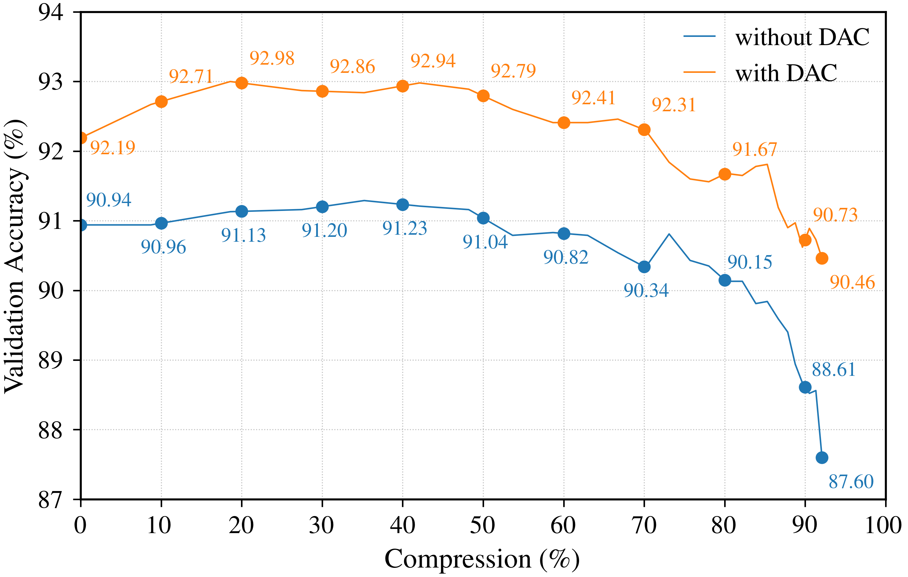

# Experiment Descriptions

Experiments are organized in the following manner:

```
experiments/
├── configs/            # Configuration files for the experiments
└── results/            # Results of the experiments
```

An experiment folder contains an `Experiment_Orchestrator_Config.toml` file and multiple `Run-xy.toml` files. The
orchestrator config defines which runs to execute. The parameters of the specific run are in the run config files.

An example experiment can be found in [Experiment_XY](configurations/Experiment_XY). The name of the experiment folder is
passed as an argument to the `runner.py` script.
To execute an experiment, use the following command:

```bash
uv run runner.py --gpu 0 --experiment Experiment_XY
```


---

## Experiment 1: Baselines Teacher & Students on EuroSAT

**Goal:** Train baseline models on EuroSAT dataset with different band combinations to establish performance benchmarks
for subsequent experiments. Models used:
- ResNetTiny (1M)
- ResNet10mini (2M)
- ResNet10 (5M)
- ResNet18 (11M)
- ResNet50 (24M) → Used as teacher later

**Description**

- Models: ResNet50 ResNet18 (teacher), ResNet10, TinyCNN (students)
- Dataset: EuroSAT (`blanchon/EuroSAT_MSI`)
- Baseline were generated for different Band combinations:
    1. All bands: ["B01", "B02", "B03", "B04", "B05", "B06", "B07", "B08", "B8A", "B09", "B11", "B12"]
    2. RGB bands: ["B02", "B03", "B04"]
    3. Vegetation indices + RGB bands: ["NDVI", "NDWI", "NDMI"]["B02", "B03", "B04", "B07", "B08"]


**Outcomes**

- Baseline results for all models and band combinations
- Even the smallest model (TinyCNN) achieves accuracy ~90.00% when trained with all bands
- The best band combination is using all bands, followed by vegetation indices + RGB bands, and finally RGB bands only.

**Results**

- [Results](results/Experiment_1/experiment_summary.md)

| Model        | Accuracy + Std. |
|--------------|-----------------|
| ResNetTiny   | 95.77 +/- 0.06  |
| ResNet10mini | 96.41 +/- 0.09  |
| ResNet10     | 98.37 +/- 0.05  |
| ResNet18     | 98.34 +/- 0.05  |
| ResNet50     | 96.79 +/- 0.18  |

---

## Experiment 1a: Baseline Teacher & Student on RESISC45

**Goal:** In this experiment we will establish a baseline using the `RESISC45` dataset. Models used:
- ResNetTiny (1M)
- ResNet10mini (2M)
- ResNet10 (5M)
- ResNet18 (11M)
- ResNet50 (24M) → Used as teacher later

**Outcomes**
- [Exp 1a Run 7](results/Experiment_1a/Run_7) has proven to achieve the best results on RESISC45 Dataset and will be used as Teacher model for all following experiments.

**Results**
- [Results](results/Experiment_1a/experiment_summary.md)

| Model        | Accuracy + Std. |
|--------------|-----------------|
| ResNetTiny   | 80.15 +/- 0.54  |
| ResNet10mini | 83.43 +/- 0.44  |
| ResNet10     | 88.33 +/- 0.19  |
| ResNet18     | 89.76 +/- 0.14  |
| ResNet50     | 92.44 +/- 0.15  |

---

## Experiment 2: KD Hyperparameter-tuning - EuroSAT, ResNetTiny, ResNet50

**Goal:** Train the smaller models (ResNetTiny) with teacher-student training. Use the best teacher model (best validation
loss) of ResNet50 as a guiding teacher.
In this experiment we will do hyperparameter tuning for the student model training. Also, we use different knowledge
distillation methods such as CosineEmbeddingLoss, CrossEntropyLoss and KLDivergenceLoss.


**Outcomes**

- 

**Results**
- [Results](results/Experiment_2/experiment_summary.md)

---

## Experiment 2a: KD Hyperparameter-tuning - RESISC45, ResNetTiny, ResNet50

**Goal:** Train the smaller models (ResNetTiny) with teacher-student training. Use the best teacher model (best validation
loss) of ResNet50 as a guiding teacher.
In this experiment we will do hyperparameter tuning for the student model training. Also, we use different knowledge
distillation methods such as CosineEmbeddingLoss, CrossEntropyLoss and KLDivergenceLoss.


**Outcomes**

- 

**Results**
- [Results](results/Experiment_2a/experiment_summary.md)

---


## Experiment 3: KD Hyperparameter-tuning - EuroSAT, ResNet18, ResNet50

**Goal:** Train the smaller model (ResNet18) with teacher-student training. Use the best teacher model ( the best
validation accuracy) ResNet50 as a guiding teacher.
In this experiment we will do hyperparameter tuning for the student model training. Also, we use different knowledge
distillation methods such as CosineEmbeddingLoss, CrossEntropyLoss and KLDivergenceLoss.


**Outcomes**

- The baseline of the Student model (ResNet18) could be beaten with Teacher-Student learning using ResNet50 as teacher.
- The student model achieved better performance than the teacher model. --> Dataset could be to simple and therefore we
  change it to a more complex one in future experiments.
- Build Baseline for models on `RESISC45` Dataset (Experiment 3a)

**Results**
- [Results](results/Experiment_3/experiment_summary.md)

--

## Experiment 3a: KD Hyperparameter-tuning - RESISC45, ResNet18, ResNet50

**Goal:** Train the smaller model (ResNet18) with teacher-student training. Use the best teacher model ( the best
validation accuracy) ResNet50 as a guiding teacher.
In this experiment we will do hyperparameter tuning for the student model training. Also, we use different knowledge
distillation methods such as CosineEmbeddingLoss, CrossEntropyLoss and KLDivergenceLoss.


**Outcomes**
- df

**Results**
- [Results](results/Experiment_3a/experiment_summary.md)

---

## Experiment 4: KD Hyperparameter-tuning - EuroSAT, ResNet10, ResNet50

**Goal:** Train the smaller model (ResNet18) with teacher-student training. Use the best teacher model ( the best
validation accuracy) ResNet50 as a guiding teacher.
In this experiment we will do hyperparameter tuning for the student model training. Also, we use different knowledge
distillation methods such as CosineEmbeddingLoss, CrossEntropyLoss and KLDivergenceLoss.


**Outcomes**
- df

**Results**
- [Results](results/Experiment_4/experiment_summary.md)

---

## Experiment 4a: KD Hyperparameter-tuning - RESISC45, ResNet10, ResNet50

**Goal:** Train the smaller model (ResNet18) with teacher-student training. Use the best teacher model ( the best
validation accuracy) ResNet50 as a guiding teacher.
In this experiment we will do hyperparameter tuning for the student model training. Also, we use different knowledge
distillation methods such as CosineEmbeddingLoss, CrossEntropyLoss and KLDivergenceLoss.


**Outcomes**
- df

**Results**
- [Results](results/Experiment_4a/experiment_summary.md)

---

## Experiment 5: KD Hyperparameter-tuning - EuroSAT, ResNet10mini, ResNet50

**Goal:** Train the smaller model (ResNet10mini) with teacher-student training. Use the best teacher model ( the best
validation accuracy) ResNet50 as a guiding teacher.
In this experiment we will do hyperparameter tuning for the student model training. Also, we use different knowledge
distillation methods such as CosineEmbeddingLoss, CrossEntropyLoss and KLDivergenceLoss.


**Outcomes**
- df

**Results**
- [Results](results/Experiment_5/experiment_summary.md)

---

## Experiment 5a: KD Hyperparameter-tuning - RESISC45, ResNet10mini, ResNet50

**Goal:** Train the smaller model (ResNet10mini) with teacher-student training. Use the best teacher model ( the best
validation accuracy) ResNet50 as a guiding teacher.
In this experiment we will do hyperparameter tuning for the student model training. Also, we use different knowledge
distillation methods such as CosineEmbeddingLoss, CrossEntropyLoss and KLDivergenceLoss.


**Outcomes**
- df

**Results**
- [Results](results/Experiment_5a/experiment_summary.md)

---

## Experiment 6: Pruning Hyperparameter-Tuning  - EuroSAT, ResNet18, ResNet50

**Goal:** In this Experiment we will compress the ResNet18 model using pruning techniques. The compressed models will be
fine-tuned with knowledge distillation using the ResNet50 as teacher model. This experiment was done using the best KD-hyperparameters 
found in Experiment 3. Only `EuroSAT` dataset is used.
All experiment use a ResNet18 student model trained with a ResNet50 teacher model. The model resulting form the
following was used: [Experiment 3, Run 3](results/Experiment_3/Run_3/config.toml) as starting point.

**Results**
- [Results](results/Experiment_6/experiment_summary.md)

---

## Experiment 6a: Pruning Hyperparameter-Tuning  - RESISC45, ResNet18, ResNet50

**Goal:** In this Experiment we will compress the ResNet18 model using pruning techniques. The compressed models will be
fine-tuned with knowledge distillation using the ResNet50 as teacher model. This experiment was done using the best KD-hyperparameters 
found in Experiment 3a. Only `RESISC45` dataset is used.
All experiment use a ResNet18 student model trained with a ResNet50 teacher model. The model resulting form the
following was used: [Experiment 3a, Run 23](results/Experiment_3a/Run_23/config.toml) as starting point.

**Results**
- [Results](results/Experiment_6a/experiment_summary.md)

---


## Experiment 7: Pruning Hyperparameter-Tuning  - EuroSAT, ResNet10, ResNet50

**Goal:** In this Experiment we will compress the ResNet18 model using pruning techniques. The compressed models will be
fine-tuned with knowledge distillation using the ResNet50 as teacher model. This experiment was done using the best KD-hyperparameters 
found in Experiment 4. Only `EuroSAT` dataset is used.
All experiment use a ResNet18 student model trained with a ResNet50 teacher model. The model resulting form the
following was used: [Experiment 4, Run 11](results/Experiment_11/Run_11/config.toml) as starting point.

**Results**
- [Results](results/Experiment_7/experiment_summary.md)

---

## Experiment 7a: Pruning Hyperparameter-Tuning  - RESISC45, ResNet10, ResNet50

**Goal:** In this Experiment we will compress the ResNet18 model using pruning techniques. The compressed models will be
fine-tuned with knowledge distillation using the ResNet50 as teacher model. This experiment was done using the best KD-hyperparameters 
found in Experiment 4a. Only `RESISC45` dataset is used.
All experiment use a ResNet18 student model trained with a ResNet50 teacher model. The model resulting form the
following was used: [Experiment 4a, Run 35](results/Experiment_3a/Run_35/config.toml) as starting point.

**Results**
- [Results](results/Experiment_7a/experiment_summary.md)

---


## Experiment 8: Ablation Experiments - EuroSAT, ResNet10, ResNet18

**Goal:** The goal of this experiment is to perform ablation studies to better understand the impact of the proposed
distillation aware pruning loop.
All ablation studies were done on the EuroSAT dataset using ResNet10 and ResNet18 as student models and ResNet50 as a
teacher.

Teacher model ResNet50: [Experiment 1, Run 10](results/Experiment_1/Run_10/config.toml)

| Run  | Description                                                                                                                                                                                                                                                                                                                                                                                            |
|------|--------------------------------------------------------------------------------------------------------------------------------------------------------------------------------------------------------------------------------------------------------------------------------------------------------------------------------------------------------------------------------------------------------|
| [1]  | Train without any teacher KD in the complete loop to get a baseline - ResNet10<br>- EuroSAT<br>**- Stage 1:** No teacher --> [Experiment 1, Run 4](results/Experiment_1/Run_4/config.toml)<br>**- Stage 2:** Compression with hyperparameter from [Experiment 7, Run 2](results/Experiment_7/Run_2/config.toml)<br>**- Stage 3:** No Teacher                                                           |
| [2]  | Train without any teacher KD in the complete loop to get a baseline - ResNet10<br>- EuroSAT<br>**- Stage 1:** No teacher --> [Experiment 1, Run 4](results/Experiment_1/Run_4/config.toml)<br>**- Stage 2:** Compression with hyperparameter from [Experiment 7, Run 11](results/Experiment_7/Run_11/config.toml)<br>**- Stage 3:** No Teacher                                                         |
| [3]  | Train without any teacher KD in the complete loop to get a baseline - ResNet18<br>- EuroSAT<br>**- Stage 1:** No teacher --> [Experiment 1, Run 1](results/Experiment_1/Run_1/config.toml)<br>**- Stage 2:** Compression with hyperparameter from [Experiment 6, Run 2](results/Experiment_6/Run_2/config.toml)<br>**- Stage 3:** No Teacher                                                           |
| [4]  | Train without any teacher KD in the complete loop to get a baseline - ResNet18<br>- EuroSAT<br>**- Stage 1:** No teacher --> [Experiment 1, Run 1](results/Experiment_1/Run_1/config.toml)<br>**- Stage 2:** Compression with hyperparameter from [Experiment 6, Run 11](results/Experiment_6/Run_11/config.toml)<br>**- Stage 3:** No Teacher                                                         |
| [5]  | Train with teacher KD only in the first stage to see if kd in second stage is necessary - ResNet10<br>- EuroSAT<br>**- Stage 1:** Train with teacher --> [Experiment 4, Run 6](results/Experiment_4/Run_6/config.toml)<br>**- Stage 2:** Compression with hyperparameter from [Experiment 7, Run 2](results/Experiment_7/Run_2/config.toml)<br>**- Stage 3:** No Teacher                               |
| [6]  | Train with teacher KD only in the first stage to see if kd in second stage is necessary - ResNet10<br>- EuroSAT<br>**- Stage 1:** Train with teacher --> [Experiment 4, Run 6](results/Experiment_4/Run_6/config.toml)<br>**- Stage 2:** Compression with hyperparameter from [Experiment 7, Run 11](results/Experiment_7/Run_11/config.toml)<br>**- Stage 3:** No Teacher                             |
| [7]  | Train with teacher KD only in the first stage to see if kd in second stage is necessary - ResNet18<br>- EuroSAT<br>**- Stage 1:** Train with teacher --> [Experiment 3, Run 3](results/Experiment_3/Run_3/config.toml)<br>**- Stage 2:** Compression with hyperparameter from [Experiment 6, Run 2](results/Experiment_6/Run_2/config.toml)<br>**- Stage 3:** No Teacher                               |
| [8]  | Train with teacher KD only in the first stage to see if kd in second stage is necessary - ResNet18<br>- EuroSAT<br>**- Stage 1:** Train with teacher --> [Experiment 3, Run 3](results/Experiment_3/Run_3/config.toml)<br>**- Stage 2:** Compression with hyperparameter from [Experiment 6, Run 11](results/Experiment_6/Run_11/config.toml)<br>**- Stage 3:** No Teacher                             |
| [9]  | Train with teacher KD only in the second stage to see if kd in first stage is necessary - ResNet10<br>- EuroSAT<br>**- Stage 1:** No teacher --> [Experiment 1, Run 4](results/Experiment_1/Run_4/config.toml)<br>**- Stage 2:** Compression with hyperparameter from [Experiment 7, Run 2](results/Experiment_7/Run_2/config.toml)<br>**- Stage 3:** Train with teacher --> use model after pruning   |
| [10] | Train with teacher KD only in the second stage to see if kd in first stage is necessary - ResNet10<br>- EuroSAT<br>**- Stage 1:** No teacher --> [Experiment 1, Run 4](results/Experiment_1/Run_4/config.toml)<br>**- Stage 2:** Compression with hyperparameter from [Experiment 7, Run 11](results/Experiment_7/Run_11/config.toml)<br>**- Stage 3:** Train with teacher --> use model after pruning |
| [11] | Train with teacher KD only in the second stage to see if kd in first stage is necessary - ResNet18<br>- EuroSAT<br>**- Stage 1:** No teacher --> [Experiment 1, Run 1](results/Experiment_1/Run_1/config.toml)<br>**- Stage 2:** Compression with hyperparameter from [Experiment 6, Run 2](results/Experiment_6/Run_2/config.toml)<br>**- Stage 3:** Train with teacher --> use model after pruning   |
| [12] | Train with teacher KD only in the second stage to see if kd in first stage is necessary - ResNet18<br>- EuroSAT<br>**- Stage 1:** No teacher --> [Experiment 1, Run 1](results/Experiment_1/Run_1/config.toml)<br>**- Stage 2:** Compression with hyperparameter from [Experiment 6, Run 11](results/Experiment_6/Run_11/config.toml)<br>**- Stage 3:** Train with teacher --> use model after pruning |


### ResNet10 on EuroSAT
| Model                                                | Parameter | Validation Accuracy (%) std | Run ID                                                                          | Notes                                                       |
|------------------------------------------------------|-----------|-----------------------------|---------------------------------------------------------------------------------|-------------------------------------------------------------|
| ResNet10 - Our Baseline                              | 4,921,197 | 98.37 +/- 0.05              | [Experiment 1, Run_4](results/Experiment_1/Run_4)                               | Train from scratch without a teacher for 50 epochs          |
| ResNet10 + KD                                        | 4,921,197 | 98.37 +/- 0.03              | [Experiment 4, Run_6](results/Experiment_4/Run_6)                               | Train from scratch with a teacher for 50 epochs             |
| ResNet10 - No KD + Pruning (34.59%) - No KD          | 3,210,783 | 98.33 +/- 0.05              | [Experiment 8, Run_1](results/Experiment_8/Run_1)                               | Compress model ResNet10 - Baseline and fine-tune without KD |
| ResNet10 - No KD + Pruning (34.59%) + KD             | 3,210,783 | 98.33 +/- 0.05              | [Experiment 8, Run_9](results/Experiment_8/Run_9)                               | Compress model ResNet10 - No KD and fine-tune with KD       |
| ResNet10 + KD + Pruning (34.59%) - No KD             | 3,210,783 | 98.10 +/- 0.10              | [Experiment 8, Run_5](results/Experiment_8/Run_5)                               | Compress model ResNet10 - KD and fine-tune without KD       |
| ResNet10 + KD + Pruning (34.59%) + KD                | 3,210,783 | 98.22 +/- 0.07              | [Experiment 7, Run_2](results/Experiment_7/Run_2)                               | Compress model ResNet10 - KD and fine-tune with KD          |
| ResNet10 - No KD + Pruning (63.12%) - No KD          | 1,810,324 | 98.15 +/- 0.07              | [Experiment 8, Run_2](results/Experiment_8/Run_2)                               | Compress model ResNet10 - Baseline and fine-tune without KD |
| ResNet10 - No KD + Pruning (63.12%) + KD             | 1,810,324 | 98.15 +/- 0.07              | [Experiment 8, Run_10](results/Experiment_8/Run_10)                             | Compress model ResNet10 - No KD and fine-tune with KD       |
| ResNet10 + KD + Pruning (63.12%) - No KD             | 1,810,324 | 98.25 +/- 0.13              | [Experiment 8, Run_6](results/Experiment_8/Run_6)                               | Compress model ResNet10 - KD and fine-tune without KD       |
| ResNet10 + KD + Pruning (63.12%) + KD                | 1,810,324 | 98.34 +/- 0.09              | [Experiment 7, Run_11](results/Experiment_7/Run_11)                             | Compress model ResNet10 - KD and fine-tune with KD          |
| ResNet10 + 7 iterations of KD aware compression loop | 1,254,026 | 97.91 +/- 0.08              | [Experiment 10, Run_7, Iteration 7](../experiments/results/Experiment_10/Run_7) | Distillation-Aware compression loop with 7 iterations       |
| ResNet10 + 9 iterations of KD aware compression loop | 793,109   | 97.89 +/- 0.11              | [Experiment 10, Run_7, Iteration 9](../experiments/results/Experiment_10/Run_7) | Distillation-Aware compression loop with 9 iterations       |


### ResNet18 on EuroSAT
| Model                                                | Parameter | Validation Accuracy (%) std | Run ID                                                                        | Notes                                                       |
|------------------------------------------------------|-----------|-----------------------------|-------------------------------------------------------------------------------|-------------------------------------------------------------|
| ResNet18 - Our Baseline                              | 4,921,197 | 98.34 +/- 0.05              | [Experiment 1, Run_1](results/Experiment_1/Run_1)                             | Train from scratch without a teacher for 50 epochs          |
| ResNet18 + KD                                        | 4,921,197 | 98.61 +/- 0.08              | [Experiment 3, Run_3](results/Experiment_3/Run_3)                             | Train from scratch with a teacher for 50 epochs             |
| ResNet18 - No KD + Pruning (46.03%) - No KD          | 6,032,870 | 98.24 +/- 0.02              | [Experiment 8, Run_3](results/Experiment_8/Run_3)                             | Compress model ResNet18 - Baseline and fine-tune without KD |
| ResNet18 - No KD + Pruning (46.03%) + KD             | 6,032,870 | 98.46 +/- 0.04              | [Experiment 8, Run_11](results/Experiment_8/Run_11)                           | Compress model ResNet18 - No KD and fine-tune with KD       |
| ResNet18 + KD + Pruning (46.03%) - No KD             | 6,032,870 | 98.37 +/- 0.06              | [Experiment 8, Run_7](results/Experiment_8/Run_7)                             | Compress model ResNet18 - KD and fine-tune without KD       |
| ResNet18 + KD + Pruning (46.03%) + KD                | 6,032,870 | 98.48 +/- 0.06              | [Experiment 6, Run_2](results/Experiment_6/Run_2)                             | Compress model ResNet18 - KD and fine-tune with KD          |
| ResNet18 - No KD + Pruning (75.00%) - No KD          | 2,794,281 | 97.82 +/- 0.10              | [Experiment 8, Run_4](results/Experiment_8/Run_4)                             | Compress model ResNet18 - Baseline and fine-tune without KD |
| ResNet18 - No KD + Pruning (75.00%) + KD             | 2,794,281 | 98.09 +/- 0.06              | [Experiment 8, Run_12](results/Experiment_8/Run_12)                           | Compress model ResNet18 - No KD and fine-tune with KD       |
| ResNet18 + KD + Pruning (75.00%) - No KD             | 2,794,281 | 98.20 +/- 0.04              | [Experiment 8, Run_8](results/Experiment_8/Run_8)                             | Compress model ResNet18 - KD and fine-tune without KD       |
| ResNet18 + KD + Pruning (75.00%) + KD                | 2,794,281 | 98.41 +/- 0.16              | [Experiment 6, Run_11](results/Experiment_6/Run_11)                           | Compress model ResNet18 - KD and fine-tune with KD          |
| ResNet18 + 7 iterations of KD aware compression loop | 1,712,604 | 97.63 +/- 0.11              | [Experiment 9, Run_5, Iteration 7](../experiments/results/Experiment_9/Run_5) | Distillation-Aware compression loop with 7 iterations       |
| ResNet18 + 9 iterations of KD aware compression loop | 922,201   | 96.97 +/- 0.46              | [Experiment 9, Run_7, Iteration 9](../experiments/results/Experiment_9/Run_7) | Distillation-Aware compression loop with 9 iterations       |

---

## Experiment 8a: Ablation Experiments - RESISC45, ResNet10, ResNet18

**Goal:** The goal of this experiment is to perform ablation studies to better understand the impact of the proposed
distillation aware pruning loop.
All ablation studies were done on the Resisc45 dataset using ResNet10 and ResNet18 as student models and ResNet50 as a
teacher.


| Run  | Description                                                                                                                                                                                                                                                                                                                                                                     |
|------|---------------------------------------------------------------------------------------------------------------------------------------------------------------------------------------------------------------------------------------------------------------------------------------------------------------------------------------------------------------------------------|
| [1]  | Train without any teacher KD in the complete loop to get a baseline - ResNet10<br>- Resisc45<br>**- Stage 1:** No teacher --> [Experiment 1a, Run 2](results/Experiment_1a/Run_2/config.toml)<br>**- Stage 2:** Compression with hyperparameter from [Experiment 7a, Run 5](results/Experiment_7a/Run_5/config.toml)<br>**- Stage 3:** No Teacher                               |
| [2]  | Train without any teacher KD in the complete loop to get a baseline - ResNet10<br>- Resisc45<br>**- Stage 1:** No teacher --> [Experiment 1a, Run 2](results/Experiment_1a/Run_2/config.toml)<br>**- Stage 2:** Compression with hyperparameter from [Experiment 7a, Run 6](results/Experiment_7a/Run_6/config.toml)<br>**- Stage 3:** No Teacher                               |
| [3]  | Train without any teacher KD in the complete loop to get a baseline - ResNet18<br>- Resisc45<br>**- Stage 1:** No teacher --> [Experiment 1a, Run 1](results/Experiment_1a/Run_1/config.toml)<br>**- Stage 2:** Compression with hyperparameter from [Experiment 6a, Run 1](results/Experiment_6a/Run_1/config.toml)<br>**- Stage 3:** No Teacher                               |
| [4]  | Train without any teacher KD in the complete loop to get a baseline - ResNet18<br>- Resisc45<br>**- Stage 1:** No teacher --> [Experiment 1a, Run 1](results/Experiment_1a/Run_1/config.toml)<br>**- Stage 2:** Compression with hyperparameter from [Experiment 6a, Run 3](results/Experiment_6a/Run_3/config.toml)<br>**- Stage 3:** No Teacher                               |
| [5]  | Train with teacher KD only in the first stage to see if kd in second stage is necessary - ResNet10<br>- Resisc45<br>**- Stage 1:** Train with teacher --> [Experiment 4a, Run 35](results/Experiment_4a/Run_35/config.toml)<br>**- Stage 2:** Compression with hyperparameter from [Experiment 7a, Run 5](results/Experiment_7a/Run_5/config.toml)<br>**- Stage 3:** No Teacher |
| [6]  | Train with teacher KD only in the first stage to see if kd in second stage is necessary - ResNet10<br>- Resisc45<br>**- Stage 1:** Train with teacher --> [Experiment 4a, Run 35](results/Experiment_4a/Run_35/config.toml)<br>**- Stage 2:** Compression with hyperparameter from [Experiment 7a, Run 6](results/Experiment_7a/Run_6/config.toml)<br>**- Stage 3:** No Teacher |
| [7]  | Train with teacher KD only in the first stage to see if kd in second stage is necessary - ResNet18<br>- Resisc45<br>**- Stage 1:** Train with teacher --> [Experiment 3a, Run 23](results/Experiment_3a/Run_23/config.toml)<br>**- Stage 2:** Compression with hyperparameter from [Experiment 6a, Run 1](results/Experiment_6a/Run_1/config.toml)<br>**- Stage 3:** No Teacher |
| [8]  | Train with teacher KD only in the first stage to see if kd in second stage is necessary - ResNet18<br>- Resisc45<br>**- Stage 1:** Train with teacher --> [Experiment 3a, Run 23](results/Experiment_3a/Run_23/config.toml)<br>**- Stage 2:** Compression with hyperparameter from [Experiment 6a, Run 3](results/Experiment_6a/Run_3/config.toml)<br>**- Stage 3:** No Teacher |
| [9]  | Train with teacher KD only in the second stage to see if kd in first stage is necessary - ResNet10<br>- Resisc45<br>**- Stage 1:** No teacher<br>**- Stage 2:** Compression with hyperparameter from [Experiment 7a, Run 5](results/Experiment_7a/Run_5/config.toml)<br>**- Stage 3:** Train with teacher --> use model after pruning                                           |
| [10] | Train with teacher KD only in the second stage to see if kd in first stage is necessary - ResNet10<br>- Resisc45<br>**- Stage 1:** No teacher<br>**- Stage 2:** Compression with hyperparameter from [Experiment 7a, Run 6](results/Experiment_7a/Run_6/config.toml)<br>**- Stage 3:** Train with teacher --> use model after pruning                                           |
| [11] | Train with teacher KD only in the second stage to see if kd in first stage is necessary - ResNet18<br>- Resisc45<br>**- Stage 1:** No teacher<br>**- Stage 2:** Compression with hyperparameter from [Experiment 6a, Run 1](results/Experiment_6a/Run_1/config.toml)<br>**- Stage 3:** Train with teacher --> use model after pruning                                           |
| [12] | Train with teacher KD only in the second stage to see if kd in first stage is necessary - ResNet18<br>- Resisc45<br>**- Stage 1:** No teacher<br>**- Stage 2:** Compression with hyperparameter from [Experiment 6a, Run 3](results/Experiment_6a/Run_3/config.toml)<br>**- Stage 3:** Train with teacher --> use model after pruning                                           |

### ResNet10 on RESISC45
| Model                                                | Parameter  | Validation Accuracy (%) std | Run ID                                                                            | Notes                                                       |
|------------------------------------------------------|------------|-----------------------------|-----------------------------------------------------------------------------------|-------------------------------------------------------------|
| ResNet10 - Our Baseline                              | 11,191,917 | 88.33 +/- 0.19              | [Experiment 1a, Run_2](../experiments/results/Experiment_1a/Run_2)                | Train from scratch without a teacher for 50 epochs          |
| ResNet10 + KD                                        | 11,191,917 | 89.36 +/- 0.16              | [Experiment 4a, Run_35](../experiments/results/Experiment_4a/Run_35)              | Train from scratch with a teacher for 50 epochs             |
| ResNet10 - No KD + Pruning (34.57%) - No KD          | 3,219,996  | 88.36 +/- 0.04              | [Experiment 8a, Run_1](../experiments/results/Experiment_8a/Run_1)                | Compress model ResNet10 - Baseline and fine-tune without KD |
| ResNet10 - No KD + Pruning (34.57%) + KD             | 3,219,996  | 89.62 +/- 0.16              | [Experiment 8a, Run_9](../experiments/results/Experiment_8a/Run_9)                | Compress model ResNet10 - No KD and fine-tune with KD       |
| ResNet10 + KD + Pruning (34.57%) - No KD             | 3,219,996  | 88.66 +/- 0.32              | [Experiment 8a, Run_5](../experiments/results/Experiment_8a/Run_5)                | Compress model ResNet10 - KD and fine-tune without KD       |
| ResNet10 + KD + Pruning (34.57%) + KD                | 3,219,996  | 90.29 +/- 0.06              | [Experiment 7a, Run_5](../experiments/results/Experiment_7a/Run_5)                | Compress model ResNet10 - KD and fine-tune with KD          |
| ResNet10 - No KD + Pruning (63.09%) - No KD          | 1,816,587  | 87.36 +/- 0.25              | [Experiment 8a, Run_2](../experiments/results/Experiment_8a/Run_2)                | Compress model ResNet10 - Baseline and fine-tune without KD |
| ResNet10 - No KD + Pruning (63.09%) + KD             | 1,816,587  | 88.43 +/- 0.21              | [Experiment 8a, Run_10](../experiments/results/Experiment_8a/Run_10)              | Compress model ResNet10 - No KD and fine-tune with KD       |
| ResNet10 + KD + Pruning (63.09%) - No KD             | 1,816,587  | 87.34 +/- 0.18              | [Experiment 8a, Run_6](../experiments/results/Experiment_8a/Run_6)                | Compress model ResNet10 - KD and fine-tune without KD       |
| ResNet10 + KD + Pruning (63.09%) + KD                | 1,816,587  | 88.80 +/- 0.24              | [Experiment 7a, Run_6](../experiments/results/Experiment_7a/Run_6)                | Compress model ResNet10 - KD and fine-tune with KD          |
| ResNet10 + 7 iterations of KD aware compression loop | 1,258,861  | 89.16 +/- 0.08              | [Experiment 10a, Run_1, Iteration 4](../experiments/results/Experiment_10a/Run_1) | Distillation-Aware compression loop with 7 iterations       |
| ResNet10 + 9 iterations of KD aware compression loop | 796,575    | 88.23 +/- 0.22              | [Experiment 10a, Run_1, Iteration 4](../experiments/results/Experiment_10a/Run_1) | Distillation-Aware compression loop with 9 iterations       |

### ResNet18 on RESISC45
| Model                                                | Parameter  | Validation Accuracy (%) std | Run ID                                                                          | Notes                                                       |
|------------------------------------------------------|------------|-----------------------------|---------------------------------------------------------------------------------|-------------------------------------------------------------|
| ResNet18 - Our Baseline                              | 11,191,917 | 89.76 +/- 0.14              | [Experiment 1a, Run_1](../experiments/results/Experiment_1a/Run_1)              | Train from scratch without a teacher for 50 epochs          |
| ResNet18 + KD                                        | 11,191,917 | 91.95 +/- 0.17              | [Experiment 3a, Run_23](../experiments/results/Experiment_3a/Run_23)            | Train from scratch with a teacher for 50 epochs             |
| ResNet18 - No KD + Pruning (46.03%) - No KD          | 6,040,725  | 90.78 +/- 0.11              | [Experiment 8a, Run_3](../experiments/results/Experiment_8a/Run_3)              | Compress model ResNet18 - Baseline and fine-tune without KD |
| ResNet18 - No KD + Pruning (46.03%) + KD             | 6,040,725  | 92.10 +/- 0.04              | [Experiment 8a, Run_11](../experiments/results/Experiment_8a/Run_11)            | Compress model ResNet18 - No KD and fine-tune with KD       |
| ResNet18 + KD + Pruning (46.03%) - No KD             | 6,040,725  | 82.02 +/- 0.15              | [Experiment 8a, Run_7](../experiments/results/Experiment_8a/Run_7)              | Compress model ResNet18 - KD and fine-tune without KD       |
| ResNet18 + KD + Pruning (46.03%) + KD                | 6,040,725  | 92.22 +/- 0.03              | [Experiment 6a, Run_1](../experiments/results/Experiment_6a/Run_1)              | Compress model ResNet18 - KD and fine-tune with KD          |
| ResNet18 - No KD + Pruning (74.99%) - No KD          | 2,798,648  | 87.86 +/- 0.17              | [Experiment 8a, Run_4](../experiments/results/Experiment_8a/Run_4)              | Compress model ResNet18 - Baseline and fine-tune without KD |
| ResNet18 - No KD + Pruning (74.99%) + KD             | 2,798,648  | 90.13 +/- 0.20              | [Experiment 8a, Run_12](../experiments/results/Experiment_8a/Run_12)            | Compress model ResNet18 - No KD and fine-tune with KD       |
| ResNet18 + KD + Pruning (74.99%) - No KD             | 2,798,648  | 89.98 +/- 0.29              | [Experiment 8a, Run_8](../experiments/results/Experiment_8a/Run_8)              | Compress model ResNet18 - KD and fine-tune without KD       |
| ResNet18 + KD + Pruning (74.99%) + KD                | 2,798,648  | 91.11 +/- 0.08              | [Experiment 6a, Run_3](../experiments/results/Experiment_6a/Run_3)              | Compress model ResNet18 - KD and fine-tune with KD          |
| ResNet18 + 7 iterations of KD aware compression loop | 1,715,497  | 91.61 +/- 0.24              | [Experiment 9a, Run_1, Iteration 7](../experiments/results/Experiment_9a/Run_1) | Distillation-Aware compression loop with 7 iterations       |
| ResNet18 + 9 iterations of KD aware compression loop | 923,889    | 90.64 +/- 0.15              | [Experiment 9a, Run_1, Iteration 9](../experiments/results/Experiment_9a/Run_1) | Distillation-Aware compression loop with 9 iterations       |


### Unstructured ResNet18

| Dataset  | KD          | Accuracy + Std. | Run ID                                                                    |
|----------|-------------|-----------------|---------------------------------------------------------------------------|
| RESISC45 | KD-1        | 92.59 +/- 0.02  | [Experiment 12a, Run_34-37](../experiments/results/Experiment_12a/Run_34) |
| RESISC45 | KD-2        | 92.27 +/- 0.20  | [Experiment 12a, Run_38-41](../experiments/results/Experiment_12a/Run_38) |
| RESISC45 | KD-1 + KD-2 | 92.22 +/- 0.03  | [Experiment 6a, Run_6](../experiments/results/Experiment_6a/Run_6)        |
| EuroSAT  | KD-1        | 98.58 +/- 0.06  | [Experiment 12, Run_34-37](../experiments/results/Experiment_12/Run_34)   |
| EuroSAT  | KD-2        | 98.41 +/- 0.02  | [Experiment 12, Run_38-41](../experiments/results/Experiment_12/Run_38)   |
| EuroSAT  | KD-1 + KD-2 | 98.67 +/- 0.05  | [Experiment 12, Run_42-45](../experiments/results/Experiment_12/Run_42)   |


### Small Models with KD
| Dataset  | Model        | Parameter | Validation Accuracy (%) std | Run ID                                                            |
|----------|--------------|-----------|-----------------------------|-------------------------------------------------------------------|
| EuroSAT  | ResNetTiny   | 997,694   | 96.49 +/- 0.17              | [Experiment 2, Run 18](results/Experiment_2/Run_18/config.toml)   |
| RESISC45 | ResNetTiny   | 997,694   | 82.63 +/- 0.32              | [Experiment 2a, Run 15](results/Experiment_2a/Run_15/config.toml) |
| EuroSAT  | ResNet10mini | 2,105,082 | 97.11 +/- 0.15              | [Experiment 5, Run 33](results/Experiment_5/Run_33/config.toml)   |
| RESISC45 | ResNet10mini | 2,105,082 | 86.36 +/- 0.37              | [Experiment 5a, Run 15](results/Experiment_5a/Run_15/config.toml) |
---

## Experiment 9: Loop Experiments - EuroSAT, ResNet18

**Goal:** The goal of this experiment is to perform knowledge aware compression in multiple loops to see if further improvements can be achieved.
All experiments were done on the `EuroSAT` dataset using ResNet18 as student model and ResNet50 as a teacher.
Starting point for all experiments is the model from [Experiment 3, Run 3](results/Experiment_3/Run_3/config.toml).
Teacher: [Experiment 1, Run 10](results/Experiment_1/Run_10/config.toml)

**Results**
- [Results](results/Experiment_9/experiment_summary.md)
---


## Experiment 9a: Loop Experiments - RESISC45, ResNet18

**Goal:** The goal of this experiment is to perform knowledge aware compression in multiple loops to see if further improvements can be achieved.
All experiments were done on the `RESISC45` dataset using ResNet18 as student model and ResNet50 as a teacher.
Starting point for all experiments is the model from [Experiment 3a, Run 23](results/Experiment_3a/Run_23/config.toml).
Teacher: [Experiment 1a, Run 7](results/Experiment_1a/Run_7/config.toml)

**Results**
- [Results](results/Experiment_9a/experiment_summary.md)
---

## Experiment 10: Loop Experiments - EuroSAT, ResNet10

**Goal:** The goal of this experiment is to perform knowledge aware compression in multiple loops to see if further improvements can be achieved.
All experiments were done on the `EuroSAT` dataset using ResNet10 as student model and ResNet50 as a teacher.
Starting point for all experiments is the model from [Experiment 4, Run 11](results/Experiment_4/Run_11/config.toml).
Teacher: [Experiment 1, Run 10](results/Experiment_1/Run_10/config.toml)

**Results**
- [Results](results/Experiment_10/experiment_summary.md)
---

## Experiment 10a: Loop Experiments - RESISC45, ResNet10

**Goal:** The goal of this experiment is to perform knowledge aware compression in multiple loops to see if further improvements can be achieved.
All experiments were done on the `RESISC45` dataset using ResNet10 as student model and ResNet50 as a teacher.
Starting point for all experiments is the model from [Experiment 4a, Run 35](results/Experiment_4a/Run_35/config.toml).
Teacher: [Experiment 1a, Run 7](results/Experiment_1a/Run_7/config.toml)

**Results**
- [Results](results/Experiment_10a/experiment_summary.md)
---


## Experiment 11: Seed Baseline EuroSAT
**Goal:** Different seeds for all baseline runs for Experiment 1.

**Results**
- [Results](results/Experiment_11/experiment_summary.md)
---

## Experiment 11a: Seed Baseline RESISC45
**Goal:** Different seeds for all baseline runs for Experiment 1a.

**Results**
- [Results](results/Experiment_11a/experiment_summary.md)
---

## Experiment 12: Seed Runs for EuroSAT and ResNet18
**Goal:** The goal of this experiment is to evaluate the stability of the baseline experiments from Experiment 8 on EuroSAT with different random seeds.
ResNet18.

**Descriptions**
- 1-3 KD --> [Exp 3, Run 3](results/Experiment_3/Run_3)
- 4-6 ResNet18 - No KD + Pruning (+) - No KD --> [Exp 8, Run 3](results/Experiment_8/Run_3)
- 7-9 ResNet18 - No KD + Pruning (+) + KD --> [Exp 8, Run 11](results/Experiment_8/Run_11)
- 10-12 ResNet18 + KD + Pruning (+) - No KD --> [Exp 8, Run 7](results/Experiment_8/Run_7)
- 13-15 ResNet18 + KD + Pruning (+) + KD --> [Exp 6, Run 2](results/Experiment_6/Run_2)
- 16-18 ResNet18 - No KD + Pruning (++) - No KD --> [Exp 8, Run 4](results/Experiment_8/Run_4)
- 19-21 ResNet18 - No KD + Pruning (++) + KD --> [Exp 8, Run 12](results/Experiment_8/Run_12)
- 22-24 ResNet18 + KD + Pruning (++) - No KD --> [Exp 8, Run 8](results/Experiment_8/Run_8)
- 25-27 ResNet18 + KD + Pruning (++) + KD --> [Exp 6, Run 11](results/Experiment_6/Run_11)
- 28-30 ResNet18 + 7 iterations of KD aware compression loop --> [Exp 9, Run 5](results/Experiment_9/Run_5)
- 31-33 ResNet18 + 9 iterations of KD aware compression loop --> [Exp 9, Run 7](results/Experiment_9/Run_7)

**Results**
- [KD Experiments](results/Experiment_12/experiment_summary_kd.md)
- [Pruning Experiments](results/Experiment_12/experiment_summary_pruning.md)
- [Loop Experiments](results/Experiment_12/experiment_summary_loop.md)
---

## Experiment 12a: Seed Runs for RESISC45 and ResNet18
**Goal:** The goal of this experiment is to evaluate the stability of the baseline experiments from Experiment 8a on `RESISC45`' with different random seeds.
ResNet18.

**Descriptions**
- 1-3 KD --> [Exp 3a, Run 23](results/Experiment_3a/Run_23)
- 4-6 ResNet18 - No KD + Pruning (+) - No KD --> [Exp 8a, Run 3](results/Experiment_8a/Run_3)
- 7-9 ResNet18 - No KD + Pruning (+) + KD --> [Exp 8a, Run 11](results/Experiment_8a/Run_11)
- 10-12 ResNet18 + KD + Pruning (+) - No KD --> [Exp 8a, Run 7](results/Experiment_8a/Run_7)
- 13-15 ResNet18 + KD + Pruning (+) + KD --> [Exp 6a, Run 1](results/Experiment_6a/Run_1)
- 16-18 ResNet18 - No KD + Pruning (++) - No KD --> [Exp 8a, Run 4](results/Experiment_8a/Run_4)
- 19-21 ResNet18 - No KD + Pruning (++) + KD --> [Exp 8a, Run 12](results/Experiment_8a/Run_12)
- 22-24 ResNet18 + KD + Pruning (++) - No KD --> [Exp 8a, Run 8](results/Experiment_8a/Run_8)
- 25-27 ResNet18 + KD + Pruning (++) + KD --> [Exp 6a, Run 3](results/Experiment_6a/Run_3)
- 28-30 ResNet18 + compression loop --> [Exp 9a, Run 1](results/Experiment_9a/Run_1)
- 31-33 ResNet18 + unstructured pruning --> [Exp 6a, Run 6](results/Experiment_6a/Run_6)

**Results**
- [KD Experiments](results/Experiment_12a/experiment_summary_kd.md)
- [Pruning Experiments](results/Experiment_12a/experiment_summary_pruning.md)
- [Loop Experiments](results/Experiment_12a/experiment_summary_loop.md)
---


## Experiment 13: Seed Runs for EuroSAT and ResNet10
**Goal:** The goal of this experiment is to evaluate the stability of the baseline experiments from Experiment 8 on `EuroSAT` with different random seeds.
ResNet10.

**Descriptions**
- 1-3 KD --> [Exp 4, Run 11](results/Experiment_4/Run_11)
- 4-6 ResNet10 - No KD + Pruning (+) - No KD --> [Exp 8, Run 1](results/Experiment_8/Run_1)
- 7-9 ResNet10 - No KD + Pruning (+) + KD --> [Exp 8, Run 9](results/Experiment_8/Run_9)
- 10-12 ResNet10 + KD + Pruning (+) - No KD --> [Exp 8, Run 5](results/Experiment_8/Run_5)
- 13-15 ResNet10 + KD + Pruning (+) + KD --> [Exp 7, Run 2](results/Experiment_7/Run_2)
- 16-18 ResNet10 - No KD + Pruning (++) - No KD --> [Exp 8, Run 2](results/Experiment_8/Run_2)
- 19-21 ResNet10 - No KD + Pruning (++) + KD --> [Exp 8, Run 10](results/Experiment_8/Run_10)
- 22-24 ResNet10 + KD + Pruning (++) - No KD --> [Exp 8, Run 6](results/Experiment_8/Run_6)
- 25-27 ResNet10 + KD + Pruning (++) + KD --> [Exp 7, Run 11](results/Experiment_7/Run_11)
- 28-30 ResNet10 + compression loop --> [Exp 10, Run 7](results/Experiment_10/Run_7)

**Results**
- [KD Experiments](results/Experiment_13/experiment_summary_kd.md)
- [Pruning Experiments](results/Experiment_13/experiment_summary_pruning.md)
- [Loop Experiments](results/Experiment_13/experiment_summary_loop.md)
---


## Experiment 13a: Seed Runs for RESISC45 and ResNet10
**Goal:** The goal of this experiment is to evaluate the stability of the baseline experiments from Experiment 8a on `RESISC45`' with different random seeds.
ResNet10.

**Descriptions**
- 1-3 KD --> [Exp 4a, Run 35](results/Experiment_4a/Run_35)
- 4-6 ResNet10 - No KD + Pruning (+) - No KD --> [Exp 8a, Run 1](results/Experiment_8a/Run_1)
- 7-9 ResNet10 - No KD + Pruning (+) + KD --> [Exp 8a, Run 9](results/Experiment_8a/Run_9)
- 10-12 ResNet10 + KD + Pruning (+) - No KD --> [Exp 8a, Run 5](results/Experiment_8a/Run_5)
- 13-15 ResNet10 + KD + Pruning (+) + KD --> [Exp 7a, Run 5](results/Experiment_7a/Run_5)
- 16-18 ResNet10 - No KD + Pruning (++) - No KD --> [Exp 8a, Run 2](results/Experiment_8a/Run_2)
- 19-21 ResNet10 - No KD + Pruning (++) + KD --> [Exp 8a, Run 10](results/Experiment_8a/Run_10)
- 22-24 ResNet10 + KD + Pruning (++) - No KD --> [Exp 8a, Run 6](results/Experiment_8a/Run_6)
- 25-27 ResNet10 + KD + Pruning (++) + KD --> [Exp 7a, Run 6](results/Experiment_7a/Run_6)
- 28-30 ResNet10 + 6 iterations of KD aware compression loop --> [Exp 10a, Run 1](results/Experiment_10a/Run_1)

**Results**
- [KD Experiments](results/Experiment_13a/experiment_summary_kd.md)
- [Pruning Experiments](results/Experiment_13a/experiment_summary_pruning.md)
- [Loop Experiments](results/Experiment_13a/experiment_summary_loop.md)
---

## Experiment 14: Comparison with and without DAC, EuroSAT and ResNet18
**Goal:** Run many iteration to compare compression with and without DAC-Loop.

**Results**
- [Results](results/Experiment_14/experiment_summary.md)

## Experiment 14a: Comparison with and without DAC, RESISC45 and ResNet18
**Goal:** Run many iteration to compare compression with and without DAC-Loop.

**Results**
- [Results](results/Experiment_14/experiment_summary.md)


